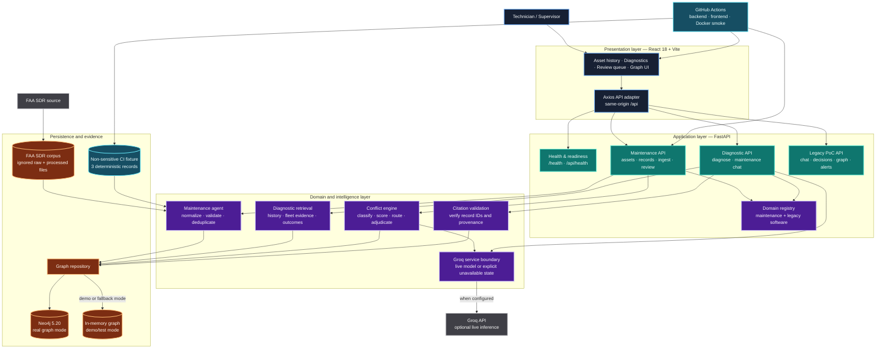
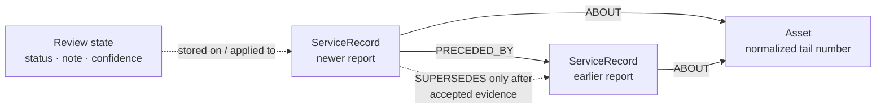
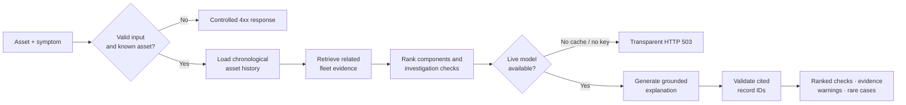

<div align="center">
  

  # HALITE

  ### AI-Powered Maintenance Diagnostics and Asset Intelligence

  **Turning fragmented maintenance history into traceable, correction-aware diagnostic evidence.**

  [](https://github.com/umaritics/halite/actions/workflows/ci.yml?query=branch%3Ausman)
  
  
  
  
  

  [Quick start](#quick-start) · [Architecture](#system-architecture) · [API](#api-surface) · [Verification](#verification-and-current-status) · [Documentation](#documentation)
</div>

---

## What is Halite?

Halite is a maintenance diagnostic support platform for exploring the technical knowledge hidden in historical service records. It organizes records around physical assets, preserves their chronology and provenance, detects corrections or contradictions, and produces evidence-linked investigation guidance.

The current FYP-I implementation focuses on a complete maintenance vertical slice:

- ingesting and normalizing FAA Service Difficulty Report (SDR) records;
- browsing assets and chronological service histories;
- storing maintenance evidence in Neo4j;
- retrieving graph-grounded historical context;
- ranking diagnostic investigation paths;
- validating record citations before presenting model-assisted explanations;
- classifying historical conflicts and routing uncertain cases to human review;
- exposing health, corpus, graph, and model state through a transparent API;
- testing the stack locally and in GitHub-hosted Docker integration runs.

Halite is **decision support**, not an airworthiness authority. It does not approve repairs, certify aircraft, authorize maintenance release, or replace licensed inspectors. Approved maintenance documentation and qualified personnel remain authoritative.

## Why it exists

Maintenance organizations accumulate valuable records, but the knowledge inside them is difficult to reuse:

- technicians describe similar symptoms with different terminology;
- early interventions may later be corrected or superseded;
- conventional search finds matching documents but does not establish which finding remains reliable;
- model-generated answers can sound certain even when the supporting history is weak;
- manual review becomes expensive as the archive grows.

Halite treats this as a problem of reasoning over **evolving technical evidence**, not merely document search. Its core question is:

> Which historical findings remain supported, which were corrected, and what investigation paths do the combined records justify?

## Core engineering principles

| Principle | How Halite applies it |
| --- | --- |
| Evidence before eloquence | Diagnostic output is grounded in retrieved records; citations are checked against stored IDs. |
| Preserve history | Superseded records remain visible as historical evidence instead of being silently overwritten. |
| Asset-aware retrieval | History is scoped to a selected asset unless cross-asset evidence is explicitly requested. |
| Conservative automation | Contradictions, partial supersession, weak confidence, and uncertain parsing route to human review. |
| Fail visibly | Missing assets, unavailable models, invalid inputs, and unavailable databases produce explicit states or errors. |
| Idempotent ingestion | Stable report identifiers prevent a second import from duplicating service records. |
| Replaceable AI boundary | The graph, provenance, conflict logic, and validation remain valuable if the external language model changes. |

## Current product experience

The React application currently provides:

- a branded landing experience and application shell;
- searchable maintenance asset lists;
- asset-specific chronological history;
- service-record browsing;
- maintenance-data ingestion controls;
- a diagnostic workspace for asset and symptom input;
- evidence, warnings, rare-case, and citation-validation presentation;
- conflict review with accept/reject actions and required rejection notes;
- graph visualization and runtime settings/status views;
- retained legacy software-domain screens used by the earlier proof of concept.

The long-term product vision includes workspace identity, multi-tenant administration, report intelligence, technician training, fleet analytics, richer hybrid retrieval, and persistent diagnostic sessions. These are roadmap capabilities—not claims about the current Mid-I build.

## System architecture

The implemented system follows a modular client-server architecture with explicit boundaries between presentation, API orchestration, domain logic, graph persistence, data ingestion, and external AI.



### Runtime modes

| Mode | Graph | Model | Intended use |
| --- | --- | --- | --- |
| Real maintenance mode | Neo4j | Groq when configured | Integrated maintenance demonstration and real-corpus validation |
| Real graph, no model | Neo4j | Unavailable/fallback state | Ingestion, history, review, and explicit HTTP 503 testing |
| Demo/test mode | In-memory graph | Deterministic fallback/stubs | Unit tests and interface development—not real-runtime evidence |

`/api/health` exposes the distinction through `demo_mode`, `graph_mode`, `using_memory_graph`, `neo4j_configured`, `maintenance_corpus_loaded`, `maintenance_record_count`, `groq_configured`, and `llm_mode`.

## Maintenance knowledge graph

The implemented Mid-I graph intentionally uses a compact, auditable core. Original report IDs and text are preserved; chronology and accepted supersession are explicit relationships.



Important integrity rules:

1. Each service record keeps its source identifier.
2. Asset links use normalized identifiers.
3. Duplicate record IDs do not create duplicate graph records.
4. Contradiction does not automatically mean supersession.
5. Rejected or superseded evidence is preserved for historical traceability.
6. Unsupported model citations are not presented as verified records.

## Diagnostic and conflict pipelines



For each new maintenance record, the conflict engine:

1. retrieves older records for the same asset;
2. limits the candidate set to avoid unnecessary all-pairs comparison;
3. classifies the relationship as `contradicts`, `supersedes`, `partial_supersedes`, `scope_disjoint`, or `no_conflict`;
4. calculates bounded confidence from explicit signals;
5. routes uncertain or sensitive results to `needs_review`;
6. applies accepted decisions without deleting the source records.

## Data profile

The project uses public FAA SDR data for research and demonstration. The locally processed Mid-I corpus currently documented by the audit contains:

| Property | Observed value |
| --- | ---: |
| Processed service records | 2,079 |
| Distinct asset identifiers | 118 |
| Author-recorded correction pairs | 141 |
| Records for demonstration asset `813SK` | 153 |
| Demonstration record | `SWIA2025111676447` |
| Preserved correction example | `AALA202501025620 → AALA202501035620` on `811NN` |

Raw and processed datasets are intentionally Git-ignored. The repository includes only a small non-sensitive fixture for deterministic CI integration tests. See [DATA_LICENCE.md](docs/DATA_LICENCE.md) and [dataset_profile.md](docs/dataset_profile.md).

## Technology stack

| Layer | Technology | Role |
| --- | --- | --- |
| Web application | React 18, React Router, Tailwind CSS, Vite | Navigation, maintenance workflows, evidence presentation |
| Visualization | Three.js, `react-force-graph-3d` | Interactive graph exploration |
| API | Python 3.11, FastAPI, Pydantic | Routing, validation, orchestration, health reporting |
| Graph persistence | Neo4j 5.20 | Assets, service records, chronology, supersession, evidence traversal |
| Model boundary | Groq SDK | Optional explanation and classification assistance |
| Data processing | pandas, Python CSV tooling | FAA acquisition, normalization, evaluation |
| Testing | PyTest, Vitest, Testing Library | Unit, API, frontend, failure-mode, and regression coverage |
| Delivery | Docker Compose, GitHub Actions, Vercel previews | Reproducible builds and hosted integration evidence |

## Quick start

### Prerequisites

- Git
- Docker Desktop with Compose v2
- At least 4 GB of free memory plus sufficient virtual memory and disk space
- Optional host development: Python 3.11+ and Node.js 20+
- Optional live inference: a Groq API key

### 1. Configure the environment

```bash
git clone https://github.com/umaritics/halite.git
cd halite
git switch usman

# macOS/Linux
cp backend/.env.example backend/.env

# PowerShell alternative
# Copy-Item backend/.env.example backend/.env
```

For Docker Compose, set a local Neo4j password in the shell or accept the documented development-only default. Never reuse `localdevpassword` outside local development.

### 2. Start the complete development stack

```bash
docker compose config --quiet
docker compose up --build -d
docker compose ps
```

| Service | URL |
| --- | --- |
| Web application | <http://localhost:5173> |
| API health | <http://localhost:8000/api/health> |
| FastAPI documentation | <http://localhost:8000/docs> |
| Neo4j Browser | <http://localhost:7474> |

Compose forces the backend container to use `bolt://neo4j:7687` and `DEMO_MODE=false`. The checked-in Compose file is for development: it publishes database ports, bind-mounts source code, and runs development servers. It is **not** a hardened production definition.

### 3. Confirm runtime mode

```bash
curl http://localhost:8000/api/health
```

For real-graph evidence, require at minimum:

```json
{
  "demo_mode": false,
  "using_memory_graph": false,
  "graph_mode": "neo4j"
}
```

An HTTP 200 by itself does not prove that Neo4j, the FAA corpus, or a live language model is available.

### 4. Acquire and ingest FAA SDR data

```bash
cd backend
python scripts/fetch_sdr_data.py
cd ..

curl -X POST http://localhost:8000/api/maintenance/ingest \
  -H "Content-Type: application/json" \
  -d '{}'
```

Run the ingestion request a second time to verify idempotency. A correct second run creates zero new records and reports skipped duplicates.

> Do not run `docker compose down --volumes` against the only copy of a populated demonstration graph. The hosted CI workflow uses an ephemeral volume and may safely remove that isolated volume after its smoke test.

### 5. Exercise the core workflow

```bash
curl http://localhost:8000/api/maintenance/assets
curl http://localhost:8000/api/maintenance/assets/813SK/history
curl http://localhost:8000/api/maintenance/review-queue
```

Then open the web application, browse an asset, inspect its history, submit a diagnostic symptom, and review a conflict case.

## Host-based development

### Backend

Start Neo4j through Docker, then run FastAPI on the host:

```bash
docker compose up -d neo4j
cd backend
python -m venv .venv

# PowerShell
.venv\Scripts\Activate.ps1

# macOS/Linux
# source .venv/bin/activate

python -m pip install -r requirements.txt
python -m uvicorn main:app --reload --port 8000
```

When the backend runs on the host, use `NEO4J_URI=bolt://localhost:7687`. When it runs inside Compose, the service URI is `bolt://neo4j:7687`.

### Frontend

```bash
cd frontend
npm ci
npm run dev
```

Vite proxies `/api` and `/health` to `VITE_PROXY_TARGET`, which defaults to `http://localhost:8000`.

## Configuration

The public template is [`backend/.env.example`](backend/.env.example). Never commit the populated `.env` file.

| Variable | Purpose | Safe default/behavior |
| --- | --- | --- |
| `DEMO_MODE` | Select real graph or in-memory mode | `true` in the example; Compose overrides to `false` |
| `NEO4J_URI` | Bolt/Aura connection URI | Blank until configured |
| `NEO4J_USERNAME` | Neo4j account | `neo4j` |
| `NEO4J_PASSWORD` | Neo4j credential | Must remain secret |
| `NEO4J_DATABASE` | Target database | `neo4j` |
| `GROQ_API_KEY` | Enables live model calls | Blank means no live inference |
| `GROQ_MODEL` | Reviewed Groq model identifier | Defined in `.env.example` |
| `MAINT_DATA_DIR` | Base directory containing `processed/` | `data` relative to `backend/` |
| `MAINT_CONFIDENCE_THRESHOLD` | Conflict auto-accept threshold | `0.50`; do not tune for presentation optics |
| `MAINT_MAX_CANDIDATES` | Maximum prior records per conflict comparison | `25` |
| `FRONTEND_URL` | Allowed browser origin | `http://localhost:5173` |

The service fails explicitly when an uncached model-dependent diagnostic is requested without a live model. `groq_configured=true` indicates that a key exists; it does not prove a successful live inference.

## API surface

Interactive OpenAPI documentation is available at `/docs` when the backend is running.

### Maintenance and diagnostics

| Method | Endpoint | Purpose |
| --- | --- | --- |
| `GET` | `/api/health` | Graph, corpus, domain, threshold, and model readiness |
| `GET` | `/api/domains` | Registered domain descriptors |
| `POST` | `/api/maintenance/ingest` | Ingest the configured processed CSV or an explicit path |
| `POST` | `/api/maintenance/ingest/upload` | Upload and ingest a CSV within the size limit |
| `GET` | `/api/maintenance/assets` | List assets and record counts |
| `GET` | `/api/maintenance/assets/{asset_id}/history` | Return chronological service history |
| `GET` | `/api/maintenance/records/{record_id}` | Return conflict-aware record detail without graph mutation |
| `POST` | `/api/maintenance/records` | Ingest/process one record through conflict detection |
| `GET` | `/api/maintenance/review-queue` | List records requiring human review |
| `POST` | `/api/maintenance/review-queue/{record_id}/accept` | Accept a pending review decision |
| `POST` | `/api/maintenance/review-queue/{record_id}/reject` | Reject with a mandatory non-blank note |
| `POST` | `/api/maintenance/diagnose` | Generate an evidence-linked diagnostic investigation |
| `POST` | `/api/maintenance/chat` | Ask a graph-grounded maintenance question |

The repository also retains the earlier software-domain chat, decisions, ingestion, graph, webhook, and alert endpoints. They remain useful regression coverage but are outside the maintenance-focused Mid-I product claim.

## Verification and current status

Run the same core gates locally:

```bash
cd backend
python -m pytest -q tests/test_api_maintenance.py tests/test_conflict_engine.py tests/test_maintenance_agent.py
python -m pytest -q

cd ../frontend
npm ci
npm test -- --run
npm run build

cd ..
docker compose config --quiet
git diff --check
```

When Docker is healthy:

```bash
docker compose up --build -d
docker compose exec -T backend python scripts/verify_mid1_runtime.py
```

Expected integration marker:

```text
MID1_RUNTIME_SMOKE=PASS
```

### Evidence snapshot — 15 October 2026

| Gate | Result |
| --- | --- |
| Usman-owned maintenance/conflict/agent tests | **PASS — 59 tests** |
| Complete backend suite in CI-equivalent no-secret mode | **PASS — 102 passed, 16 explicit Neo4j skips** |
| Frontend production build locally | **PASS — 857 modules transformed** |
| Frontend test suite | **FAIL — 12 passed, 1 Shahmeer-owned stale mock failure** |
| Hosted backend job | **PASS** |
| Hosted Docker real-Neo4j synthetic integration | **PASS** |
| Overall mandatory workflow | **FAIL — frontend test gate remains red** |
| Full FAA corpus in a running isolated Neo4j database | **BLOCKED — local Docker/WSL infrastructure** |
| Persistent current staging backend | **FAIL — reachable VM exposes old API without maintenance routes** |
| Successful live Groq diagnostic | **NOT VERIFIED** |
| Independent reviewer approval | **NOT VERIFIED** |

Latest recorded closure run: [GitHub Actions 38796169387](https://github.com/umaritics/halite/actions/runs/38796169387).

The Docker job proves the container/API wiring with a three-record synthetic fixture in a real ephemeral Neo4j instance. It does **not** substitute for full FAA-corpus validation. See the independently auditable [final audit](docs/mid1/05_usman_final_audit.md) and [release-readiness handoff](docs/mid1/07_usman_release_readiness.md).

## Repository layout

```text
halite/
├── .github/workflows/ci.yml       # Backend, frontend, and Docker integration gates
├── backend/
│   ├── agents/                    # Ingestion and legacy agent services
│   ├── api/routes/                # FastAPI route modules
│   ├── domains/                   # Domain adapters and registry
│   ├── graph/                     # Neo4j client, repository, schema, memory store
│   ├── scripts/                   # Acquisition, evaluation, backfill, runtime smoke
│   ├── services/                  # Conflict, retrieval, context, and Groq boundaries
│   ├── tests/                     # Unit, API, graph, regression, and fixture tests
│   ├── config.py                  # Environment-backed settings
│   └── main.py                    # Application composition and health contract
├── frontend/
│   ├── public/                    # Brand assets
│   └── src/
│       ├── api/                   # Axios client contract
│       ├── components/            # Navigation, status, graph, evidence UI
│       ├── context/               # Domain and theme state
│       ├── pages/                 # Maintenance and legacy PoC screens
│       └── test/                  # Vitest/Testing Library coverage
├── docs/                          # Architecture, data, setup, evidence, and FYP material
├── docker-compose.yml             # Local development stack
├── docker-compose.vm.yml          # Backend-only VM service definition
└── vercel.json                    # Hosted frontend/backend service routing intent
```

## Product roadmap

| Stage | Focus | Status |
| --- | --- | --- |
| FYP-I Mid | Maintenance UI, asset history, Neo4j graph, diagnostic input, evidence retrieval, conflict review, automated tests | Current vertical slice |
| FYP-I Final | Improved hybrid ranking, multi-turn sessions, richer asset/component graph, role-aware access, deployed demonstration | Planned |
| FYP-II Early | Technician Academy, analytics, collaboration, organization administration | Planned |
| FYP-II Mid / Job Fair | Integrated, job-fair-ready product with mature workflows | Planned |
| FYP-II Final | Security, performance, evaluation, documentation, and operational hardening | Planned |

## Documentation

- [Setup and verification guide](docs/mid1_setup.md)
- [Maintenance architecture](docs/maintenance_architecture.md)
- [Dataset profile](docs/dataset_profile.md)
- [Data licence register](docs/DATA_LICENCE.md)
- [Demonstration script](docs/DEMO_SCRIPT.md)
- [Test and delivery evidence](docs/mid1_test_evidence.md)
- [Usman final audit](docs/mid1/05_usman_final_audit.md)
- [Frontend-owner handoff](docs/mid1/06_frontend_review_queue_handoff.md)
- [Release-readiness handoff](docs/mid1/07_usman_release_readiness.md)

## Team and ownership

| Team member | Student ID | Primary ownership |
| --- | --- | --- |
| Shahmeer Atif | 23I-0711 | Diagnostic interaction, frontend integration, evidence presentation, product UX |
| Muhammad Umar | 23I-0782 | Knowledge graph, retrieval, ranking, technical evaluation |
| Muhammad Usman Al Haq | 23I-0585 | Data processing, conflict intelligence, backend integration, testing, CI/CD, deployment |

Supervised by **Syed Muhammad Saad Salman** at the FAST School of Computing, National University of Computer and Emerging Sciences, Islamabad Campus.

## Responsible-use statement

Halite surfaces historical evidence and investigation options. Its outputs may be incomplete, uncertain, or dependent on external services. Users must verify every action against approved manuals, organizational procedures, applicable regulation, and qualified human judgment. No interface message, score, graph edge, or language-model response constitutes maintenance authorization or airworthiness certification.

---

<div align="center">
  <strong>HALITE</strong><br/>
  Evidence-aware maintenance intelligence—designed to remember not only what was reported, but what history later corrected.
</div>
