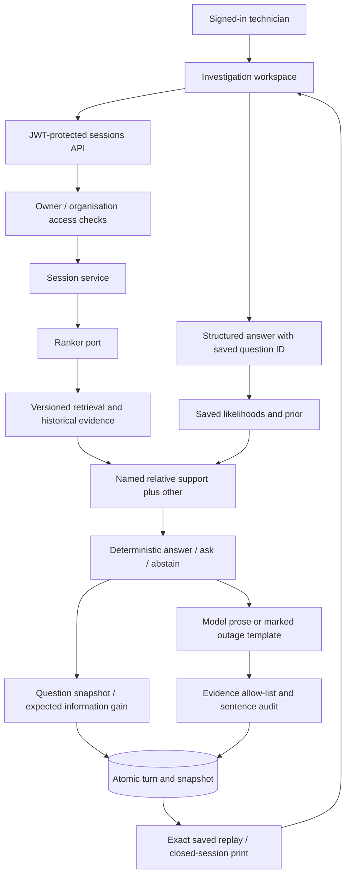

# Usman's architecture and defense preparation

AI-assisted preparation, not a record of an actual rehearsal or panel approval.
Companion: `USMAN_FINAL_REPORT_DRAFT.md`. Usman should explain these diagrams
in his own words and demonstrate the implementation before submission.

## Runtime path

The diagram describes the implemented managed path. Questioning remains behind
an explicit flag and policy; the research choice does not activate production.
Structured answers use the saved question basis, not fresh graph/model reads.
No replay edge calls the ranker. The historical stateless endpoints preserve
their compatibility contracts alongside the session service.

## Experimental path

```mermaid
flowchart LR
  Fit[2023 original/correction pairs] --> Params[Fit temperature and other score]
  Params --> Select[2024 question and joint stopping selection]
  Select --> Choice[Usman chooses .80 / .50]
  Choice --> Freeze[Hash-pinned policy and protocol]
  Freeze --> Receipt[Verify history and write pre-access receipt]
  Receipt --> Test[Fixed 2025 evaluation]
  Test --> Replay[Independent point and interval replay]
  Replay --> Files[Committed tables / traces / verifier]
  Files --> Endpoint[Authenticated read-only publication]
  Endpoint --> Charts[Product charts with sample sizes and intervals]
```

Inside every ranking path, submission-time filtering and chain exclusion precede
retrieval. Original fields answer simulated questions. Correction keys enter
only fitting or downstream evaluation; they do not answer the simulated question.

## Suggested 15-minute team presentation allocation

Agree actual allocation with Umar and Shahmeer. The following reserves about
five minutes for Usman's contribution, not an invented team agreement:

1. 45 seconds: show an owned saved investigation and explain replay/outcome.
2. 60 seconds: show relative support, the deterministic decision and a saved
   question. If live questions are disabled, use the labelled isolated demo;
   do not enable production merely for the presentation.
3. 45 seconds: inspect one sentence and its exact evidence span; explain unrated
   versus measured support and the independent-label gate.
4. 90 seconds: show the accepted 2024 marker, then fixed 2025 counts/intervals.
   State 7 answers, 5 matches, 150 abstentions and the missing-candidate finding.
5. 60 seconds: show reproducible proof and explain the next development study.

Use committed product results rather than manually typed demonstration numbers.
Retain model-down and permission-error examples as backups. Never claim a hosted
CI fixture is an authenticated production interaction.

## Questions to practise

| Panel question | Answer to understand and demonstrate |
| --- | --- |
| Why not ask the LLM for confidence? | It mixes prose with selection; this rule has explicit inputs, boundaries, saved state and replayable tests. |
| Are these probabilities? | No. They are relative support; held-out ECE is about .184 and two high-support answers missed a candidate absent from retrieval. |
| Why include other? | Softmax over named candidates alone can concentrate support even when the cause is outside that set. Other represents that alternative, without guaranteeing detection. |
| What is the cost of abstention? | Only 7/157 test cases are answered. Report the reduced coverage alongside the higher conditional match rate. |
| Does information gain help? | At fixed budget two, IG beats random by 8.92 percentage points with a positive paired interval. At budget three IG falls; the claim is conditional, not universal. |
| Why cluster the bootstrap? | Several pairs can share an original report, so independent pair resampling would understate dependence. |
| Is unsupported rate a hallucination score? | No. Here it is a top-three correction-key miss proxy. Human sentence grounding requires separate labels and generated-prose evaluation. |
| Could the correction leak into questions? | The simulator receives original fields; outcome-key scoring happens after the question path. Temporal and citation-chain guards constrain evidence reads. |
| Was 2025 completely unseen by the project? | No. An earlier ranker POC had exposure. The newly frozen configuration was evaluated without test-year tuning; that narrower claim is documented. |
| Why are changed-part cases poor? | Retrieval omitted the true part in 113/157 cases. Reweighting cannot create missing candidates; both answered misses had that problem. |
| What if the model is down? | Sessions save deterministic ranking/evidence and a marked fallback; the original stateless failure contract is kept unless degradation is explicitly requested. |
| What changes on reload? | The UI reads the saved turn, beliefs and evidence; it does not recompute the historic answer from today's graph. |
| What work is still empirical? | Independent human labels, generated-prose/L4/no-evidence evaluation and actual M4 measurements. Tool verification is not those measurements. |

## Modification exercises and rehearsal record

Practise locating `beliefs.py`, `policy.py`, `questions.py`, `sessions.py` and
their focused tests. Explain an exact threshold boundary, an exhausted question
budget, a missing candidate and a cross-owner session access attempt. Try such
changes only in an isolated development fixture; do not change frozen evaluation
inputs or accepted source pins.

Record a real rehearsal only after it happens:

| Rehearsal evidence | Actual observation |
| --- | --- |
| Participants and date | Pending |
| Measured duration | Pending |
| Questions answered without assistance | Pending |
| Code modification and executed check | Pending |
| Corrections to report/slides | Pending |

The full acceptance matrix remains `../work/usman/ACCEPTANCE_MATRIX.md`.
