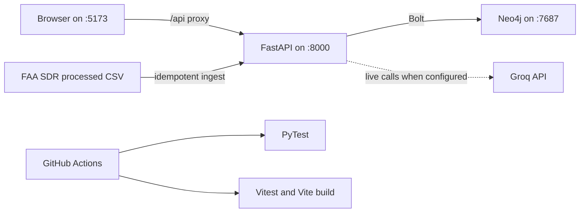

# Halite Mid-I setup and verification

This guide reproduces the maintenance-only vertical slice: Neo4j, FastAPI, the React/Vite UI, FAA SDR ingestion, health verification, and conflict-review APIs. Run commands from the repository root unless a step says otherwise.

## Requirements

- Docker Desktop with Docker Compose v2 (recommended path)
- Git
- For host-based development: Python 3.11+ and Node.js 20+
- At least 4 GB free RAM and enough disk space for container images and FAA data

Do not commit `backend/.env`, downloaded FAA CSV files, API keys, database passwords, or screenshots that expose them.

## Configuration

Copy `backend/.env.example` to `backend/.env`. Configure only the values needed for the selected mode:

| Variable | Purpose | Local Compose value |
| --- | --- | --- |
| `NEO4J_URI` | Neo4j Bolt endpoint | Overridden to `bolt://neo4j:7687` in Compose |
| `NEO4J_USERNAME` | Neo4j user | `neo4j` |
| `NEO4J_PASSWORD` | Database password | Set in the shell or use the documented local default |
| `DEMO_MODE` | Selects in-memory fallback when true | Overridden to `false` in Compose |
| `GROQ_API_KEY` | Enables live conflict/diagnosis model calls | Optional for health, required for live model behavior |
| `GROQ_MODEL` | Groq model identifier | See `.env.example` |
| `MAINT_DATA_DIR` | Base directory containing `processed/` | `data` inside the backend container |
| `MAINT_CONFIDENCE_THRESHOLD` | Conservative conflict routing threshold | Keep the reviewed value; do not tune for demo optics |

The local Compose password defaults to `localdevpassword`. To override it in PowerShell before startup:

```powershell
$env:NEO4J_PASSWORD = "choose-a-local-password"
```

Never reuse that development password for AuraDB or deployment.

## Full Docker startup

```bash
docker compose config --quiet
docker compose up --build -d
docker compose ps
```

Services:

- UI: <http://localhost:5173>
- API health: <http://localhost:8000/api/health>
- Neo4j Browser: <http://localhost:7474>

Wait until `neo4j` and `backend` report healthy. Verify the runtime:

```bash
curl http://localhost:8000/api/health
curl http://localhost:8000/api/maintenance/assets
curl http://localhost:8000/api/maintenance/review-queue
```

For a real-data demonstration, health must report `graph_mode: "neo4j"`, `using_memory_graph: false`, `demo_mode: false`, and—after ingestion—`maintenance_corpus_loaded: true` with a non-zero runtime count. `llm_mode: "fallback"` means a live Groq-backed conflict or diagnosis request must fail transparently or use an explicitly identified valid cache; it must not be presented as live inference.

## FAA SDR data and idempotent ingestion

The fetch step downloads public FAA data and creates the processed POC corpus. It requires network access and can take time.

```bash
cd backend
python scripts/fetch_sdr_data.py
cd ..
curl -X POST http://localhost:8000/api/maintenance/ingest
```

Because `backend/` is bind-mounted at `/app`, `backend/data/processed/sdr_poc_corpus.csv` is visible to the API container. Ingestion uses stable record identifiers and skips existing records. A second ingestion should report zero newly created records and a non-zero `duplicates_skipped` count; verify that before using it as idempotency evidence.

Do not run `docker compose down -v` against the only demo corpus: `-v` deletes the local Neo4j volume.

## Host development with Docker Neo4j

Start only the graph:

```bash
docker compose up -d neo4j
```

In `backend/.env`, set `NEO4J_URI=bolt://localhost:7687` and `DEMO_MODE=false`, then:

```bash
cd backend
python -m venv .venv
# PowerShell: .venv\Scripts\Activate.ps1
# bash/zsh: source .venv/bin/activate
python -m pip install -r requirements.txt
python -m uvicorn main:app --reload --port 8000
```

In a second terminal:

```bash
cd frontend
npm ci
npm run dev
```

## Test and release checks

```bash
cd backend
python -m pytest -q
cd ../frontend
npm test
npm run build
cd ..
docker compose config --quiet
```

GitHub Actions runs those backend, frontend, build, and Compose validation gates without real secrets. A local pass does not substitute for a hosted Actions run; record the passing run URL and reviewed PR before release.

The hosted Docker job additionally performs a real Neo4j integration smoke test with the non-sensitive fixture at `backend/tests/fixtures/mid1_smoke.csv`. To run the same assertions after the stack is healthy:

```bash
docker compose exec -T backend python scripts/verify_mid1_runtime.py
```

The success marker is `MID1_RUNTIME_SMOKE=PASS`. This fixture validates wiring and API behavior only; it is not evidence of FAA corpus accuracy.

## Runtime dependency diagram



## Troubleshooting

- If health reports `graph_mode: "memory"`, check `docker compose logs backend neo4j`, the Neo4j password, and service health. Do not claim real-graph operation.
- If the corpus count is zero, confirm the processed CSV exists and run the ingestion request once.
- If model-backed endpoints return 503, verify `GROQ_API_KEY` and rate limits; keep the failure visible.
- If Windows blocks `npm.ps1`, invoke `npm.cmd` or use Command Prompt.
- If ports 5173, 7474, 7687, or 8000 are occupied, stop the conflicting local service or intentionally update and document the port mapping.
