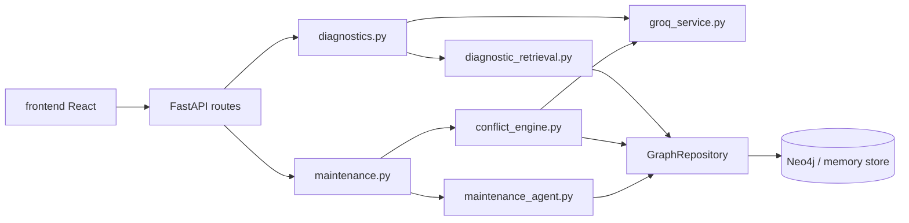

# System architecture

## Stack

| Layer | Tech |
| --- | --- |
| Frontend | React 18, Vite 5, JS/JSX, Tailwind, Axios, Vitest |
| Backend | FastAPI, Pydantic, PyTest |
| Graph | Neo4j 5 (Compose) + in-memory fallback when `DEMO_MODE=true` or Neo4j unset |
| LLM | Groq via `GroqService` (`is_live` gate); response caches for conflict + diagnose |

## Domain registry pattern

`backend/domains/registry.py` + adapters (`MaintenanceDomainAdapter`, software adapter). Maintenance is the Mid-I product domain; software adapter remains for regression.

## Runtime honesty (`/api/health`)

Critical fields: `demo_mode`, `graph_mode` (`neo4j`|`memory`), `using_memory_graph`, `llm_mode` (`live`|`fallback`), `maintenance_corpus_loaded`, `maintenance_record_count`. Never claim live Neo4j/LLM when health says otherwise.

## High-level dependency graph

## Design patterns in force

- **Adapter** for domain labels/rules.
- **Repository** (`GraphRepository`) over Neo4j/memory.
- **Pipeline** for conflict: candidates → classify → adjudicate → confidence → route.
- **Fail loud** for diagnose when LLM unavailable and no valid cache.
- **Citation allow-list**: only record IDs present in retrieved context may be confirmed.

Detail: legacy narrative in `docs/maintenance_architecture.md` (still valid for conflict/domain registry; prefer this bank for Mid-I navigation).
