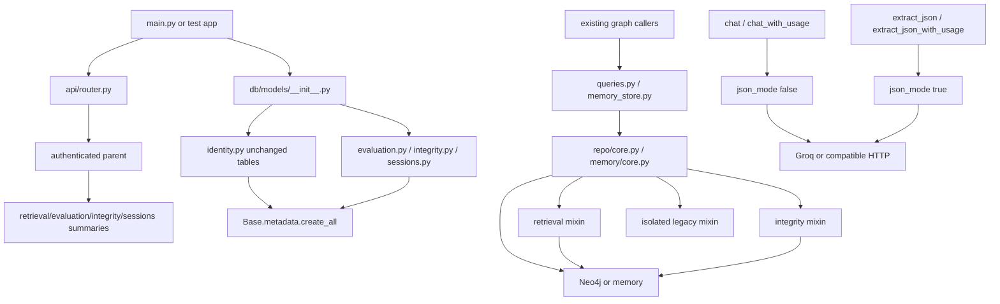
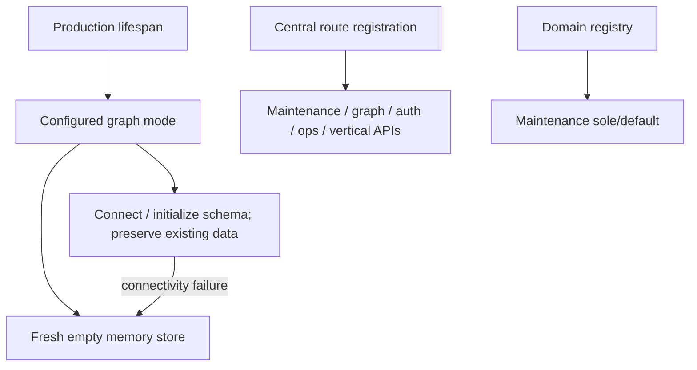

# Backend foundation flow

1. `main.py` or the test app calls `register_api_routers` once.
2. The authenticated parent mounts each vertical summary router, retaining the
   existing API-key/JWT security dependency.
3. Existing graph imports resolve through compatibility facades to mixin classes.
   Core lifecycle/CRUD delegates retrieval and integrity methods without changing
   their existing memory or Cypher behavior.
4. `db.models` imports identity and all vertical extension modules before the
   relational store invokes `Base.metadata.create_all`.
5. Model prose requests omit JSON format; extraction explicitly requests JSON.
   Provider selection and key fallback preserve that choice and token accounting.

## Failure behavior

- Summary authentication inherits production fail-closed behavior.
- Empty summary statistics mean the vertical has not supplied its implementation.
- Existing graph/API failure semantics are unchanged.
- Provider failure and empty content are errors; output-format selection never
  substitutes invented records, explanations or citations.

## Software retirement and startup

No startup branch calls seed_demo_data. Retired software routes are absent and
return 404 even if obsolete Gitea settings are true. Explicit graph fixture and
ops-protected manual-reset compatibility is retained; no data purge is part of
this retirement.
