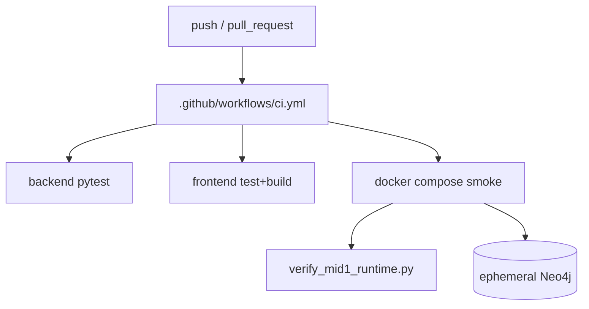

# FLOW-ci — GitHub Actions gates

## Jobs

1. **backend** — pytest with `DEMO_MODE=true`, empty Groq secrets, and an
   ephemeral Neo4j 5 service so repository contracts execute in both stores.
2. **frontend** — `npm ci`, `npm test`, `npm run build`.
3. **docker-smoke** — compose up, health, `verify_mid1_runtime.py`, frontend root HTML check, teardown.

## Dependency graph

## Mid-I evidence note

Usman audit: backend + docker jobs green; frontend job red (Shahmeer mock). Overall workflow must be green before merge claims.
