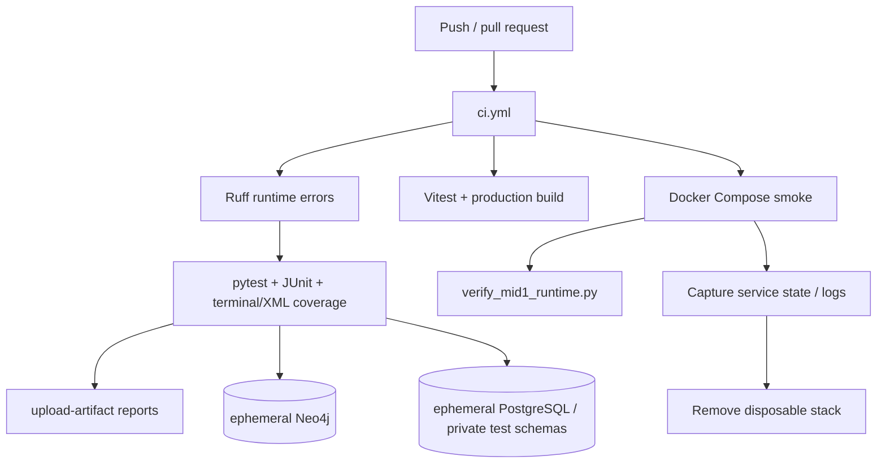
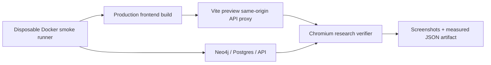
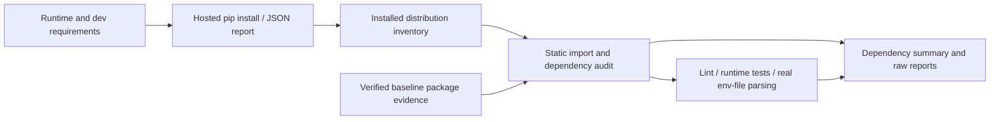
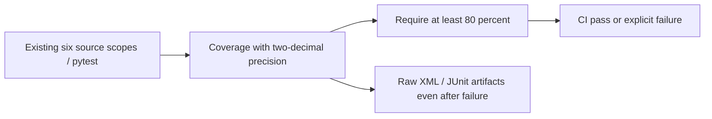

# CI verification flow

1. Pull requests (and configured branch pushes) trigger `.github/workflows/ci.yml`.
2. Backend starts ephemeral Neo4j and PostgreSQL, installs declared development
   dependencies, runs Ruff runtime-error lint and pytest with terminal/XML coverage
   plus JUnit. Session contracts run against both SQLite and a private temporary
   PostgreSQL schema; graph contracts run against both memory and Neo4j.
3. Coverage and JUnit artifacts upload even if tests fail, so failures stay reviewable.
4. Frontend installs its lockfile dependencies, runs Vitest and builds production assets.
5. Docker smoke builds/starts Compose, verifies real graph/auth/corpus APIs using the
   synthetic fixture, checks frontend HTML, captures logs and tears down its volumes.

A configured workflow is not evidence of a successful remote run. Record the run
URL and terminal job results in the work log before claiming CI passed. Coverage
scope is explicit; the NFR-04 80% target is not satisfied by a report alone.
Staging deployment remains separate and main-only; no test targets shared data.

## Hosted research page browser check

Normal chart reads use real JWT/API/artifact checksums. Only UI failure/empty
subchecks intercept responses, explicitly labelled in proof. No staging data is
used; the job tears down its own Compose volumes after verification.

## Measured dependency resolution

Pandas is an actual runtime dependency. Dotenv remains needed transitively;
removing its direct requirement does not mean the package disappears. NumPy
remains at the already-installed baseline instead of an unrelated major upgrade.

## Coverage target enforcement

No file omission or source-scope reduction is used to cross the target. Artifact
tooling tests exercise retained real inputs and explicit isolation/error paths.
