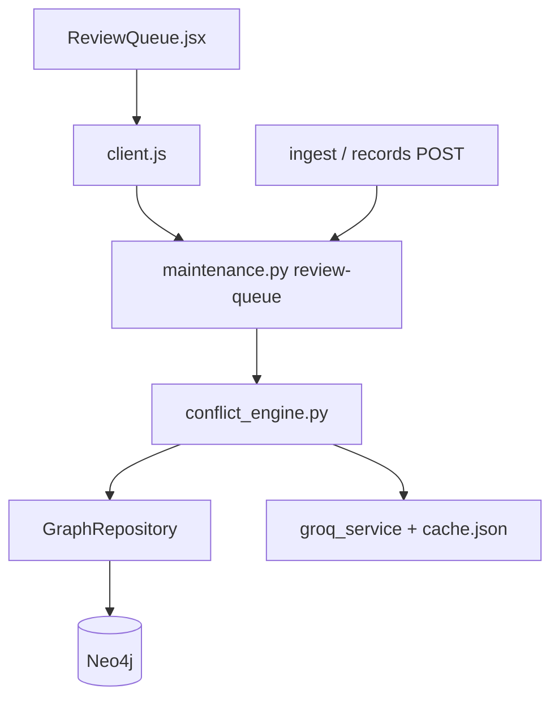

# FLOW-conflict-review

## Happy path

1. Record ingested or submitted via maintenance APIs.
2. `process_record` finds same-asset candidates → classifies → scores → routes.
3. If `needs_review`, record appears in `GET /api/maintenance/review-queue`.
4. Reviewer opens Review Queue UI; inspects prior + classification.
5. Accept → `accepted`; Reject (note required) → `rejected`. Original text preserved.

## Failure / safety

- LLM unavailable during conflict processing must not silently invent supersessions.
- The bulk conflict-score backfill exits before processing unless Groq is live;
  it invokes the engine with `allow_stub=False`.
- A record with no older candidate is persisted as scored with confidence
  `0.0`; resume mode skips any record that is no longer an untouched ingest
  placeholder.
- Do not destroy source records on reject.
- Seeded demo queue items must not be mislabeled as adjudicated diagnoses.

## Dependency graph

