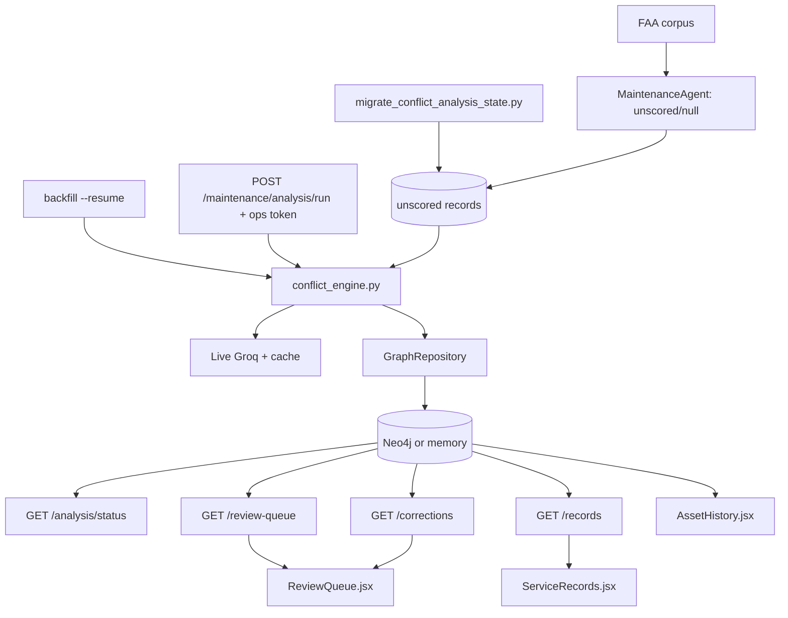

# FLOW-conflict-review

## Happy path

1. Ingest stores `analysis_state=unscored` and `confidence=null`.
2. A record call, CLI resume, or ops-token batch runs `process_record`.
3. Positive-score same-asset candidates are classified, scored and routed.
   A record with no comparable candidate becomes `scored/no_candidates`
   without an LLM call.
4. `needs_review` rows appear in `GET /maintenance/review-queue`; Accept or
   Reject preserves source text and sets `analysis_state=reviewed`.
5. Confident supersessions create `SUPERSEDES`. `GET
   /maintenance/corrections` and inline corrected-by banners read that edge.
6. `GET /maintenance/analysis/status` drives coverage and honest empty states.

## Failure and safety

- Model-dependent work fails closed unless Groq is live; stubs are never
  persisted as conflict evidence.
- Batch size is capped at 25, retries for 429 are bounded, and resume selects
  only explicit `unscored` state.
- Review failure leaves the record in the queue. Reject never deletes source
  data.
- A superseded older record shows its corrector, not a confidence score.
- API reads normalize untouched legacy `confidence=1.0` placeholders to
  `legacy_placeholder=true`, null confidence and an unscored presentation;
  this does not write the graph or hide them from the migration.
- Shared staging analysis or migration requires explicit approval.

## UI behavior

- Needs review distinguishes “analysis has not run (M unscored)” from “N
  analysed, none need review”.
- Detected corrections shows live totals, component-change rate, both records,
  rationale/status, and history links.
- Service Records defaults to All aircraft with URL filters and pagination.
- Unscored shows “Not analysed”; no-conflict shows comparison count; relation
  scores are explicitly heuristic, not probability.

## Dependency graph

