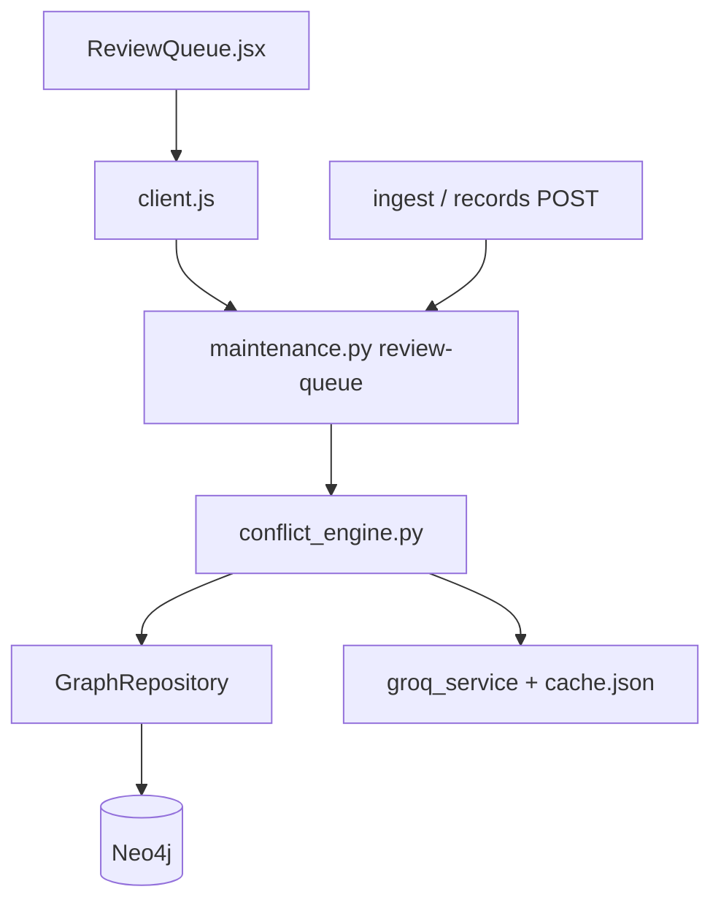

# FLOW-conflict-review

## Happy path

1. Record ingested or submitted via maintenance APIs.
2. `process_record` finds same-asset candidates → classifies → scores → routes.
3. If `needs_review`, record appears in `GET /api/maintenance/review-queue`.
4. Reviewer opens Review Queue UI; inspects prior + classification.
5. Accept → `accepted`; Reject (note required) → `rejected`. Original text preserved.
6. The UI updates only after the server confirms; on failure the record stays in the queue and the server reason is shown.

## Failure / safety

- LLM unavailable during conflict processing must not silently invent supersessions.
- Do not destroy source records on reject.
- Seeded demo queue items must not be mislabeled as adjudicated diagnoses.

## UI behaviour (ReviewQueue.jsx)

- Rows already carry the stored classification (`classification_label`, `classification_rationale`, `confidence`,
  `candidates_considered`, `history_size`). The right-hand finding is fetched with `GET /maintenance/records/{id}`, which
  re-runs the engine (a model call). If that fails (e.g. 503) the page says so, offers Retry, and shows the stored finding
  labelled as such. It never shows the previous record's finding.
- Accept/Reject are explicit buttons only (no bare-key shortcuts) and lock while a request is pending.
- "Open in asset history" links need the asset UUID, resolved from `GET /maintenance/assets`; no link is shown if it cannot be
  resolved (the history endpoint 404s on tail numbers).
- A failed queue load is shown as a failure, not as an empty queue.
- Label meanings shown to reviewers come from the engine prompt (`supersedes`, `partial_supersedes`, `contradicts`).

## Dependency graph

