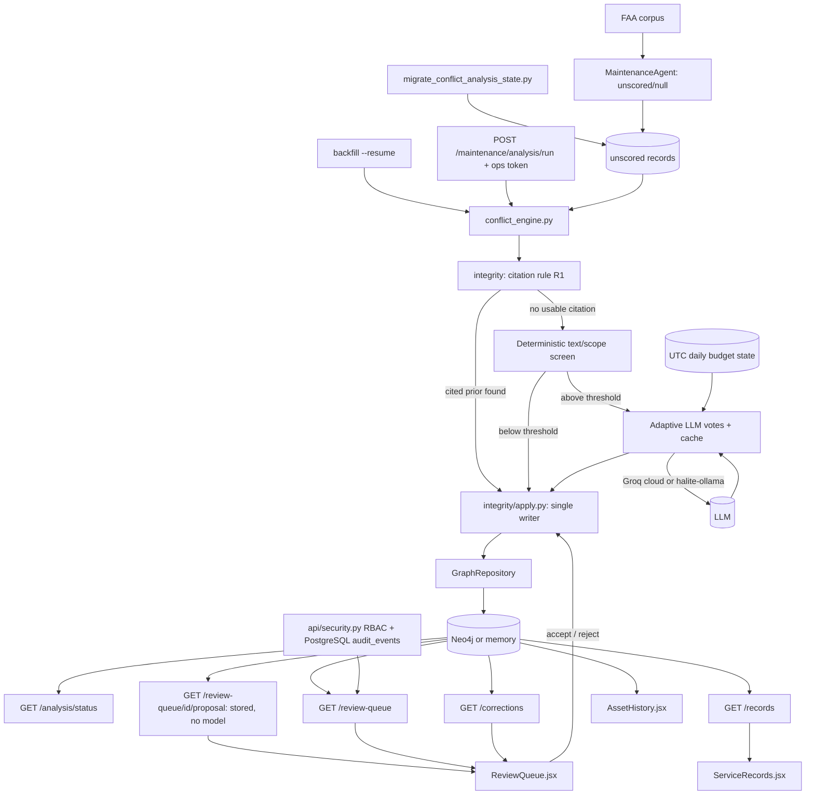

# FLOW-conflict-review

## Happy path

1. Ingest stores `analysis_state=unscored` and `confidence=null`.
2. A record call, CLI resume, or ops-token batch runs `process_record`.
3. A reviewed record is skipped. A report that cites an existing earlier same-aircraft report is linked to it by
   rule R1 with no model call. Otherwise positive-score same-asset candidates (submitted earlier, not rejected by a
   reviewer) are classified, scored and routed, and the chosen prior is stored as `proposed_prior_id`.
   A record with no comparable candidate becomes `scored/no_candidates`
   without an LLM call.
   When explicitly configured, cascade mode first applies the deterministic
   text/scope screen, then uses adaptive 2-or-5-pass model voting.
4. `needs_review` rows appear in `GET /maintenance/review-queue`. The review screen reads
   `GET /maintenance/review-queue/{id}/proposal`, which returns the stored proposal and calls no model.
   `Accept` or `Reject` requires `supervisor` or `admin` role (`403` for `technician`),
   preserves source text, sets `analysis_state=reviewed`, stamps `reviewed_by_*`
   provenance onto the `ServiceRecord`, writes a `review_decisions` row and an immutable `AuditEvent` in PostgreSQL.
   Accept creates or confirms the `SUPERSEDES` link; reject removes it and writes `NOT_SUPERSEDES`, so the pair is not proposed again.
5. Rule R1, confident model supersessions and accepted proposals create `SUPERSEDES` (one edge per pair, with method and decider). `GET
   /maintenance/corrections` and inline corrected-by banners read that edge.
6. `GET /maintenance/analysis/status` drives coverage and honest empty states.

## Failure and safety

- Model-dependent work fails closed unless a live LLM is configured (Groq cloud
  or staging Ollama); stubs are never persisted as conflict evidence.
- Batch size is capped at 25, retries for 429 are bounded, and resume selects
  only explicit `unscored` state.
- Request/token budgets persist by UTC date and model. Batch/API runs stop
  cleanly at 90% and cached classifications consume no budget.
- Re-processing never overwrites a reviewed record (unless `force`). All integrity writes go through `integrity/apply.py`.
- Review failure leaves the record in the queue. Reject never deletes source
  data.
- A superseded older record shows its corrector, not a confidence score. Validity is read from links (`integrity/validity.py`).
- API reads normalize untouched legacy `confidence=1.0` placeholders to
  `legacy_placeholder=true`, null confidence and an unscored presentation;
  this does not write the graph or hide them from the migration.
- Shared staging analysis or migration requires explicit approval.

## UI behavior

- Needs review distinguishes “analysis has not run (M unscored)” from “N
  analysed, none need review”.
- Detected corrections shows live totals, component-change rate, both records,
  rationale/status, and history links.
- Service Records defaults to All aircraft with URL filters and pagination.
- Unscored shows “Not analysed”; no-conflict shows comparison count; relation
  scores are explicitly heuristic, not probability.

## Dependency graph

