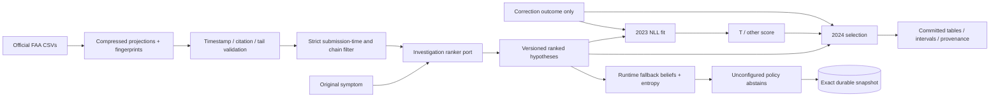

# Decision selection

1. An explicitly AI-assisted design draft precedes the pure decision code.
2. Stream official 2023/2024 sources into separate compressed projections; verify
   row fingerprints on read. This preparation does not access held-out 2025.
3. Validate timestamps, citations and tails. For every known-outcome pair, use
   original text as query and correction part only as answer key.
4. Filter every read by strictly earlier submission and exclude the query chain.
   Assign supersession only from corrections visible at that knowledge time.
5. Run the unchanged bounded Mid-I ranker through the port. Fit T/c on 2023 only.
6. Use those parameters on 2024, generate the threshold table, grouped error
   diagnostics and 1,000 cluster-bootstrap intervals; do not auto-select a point.
7. Runtime Copilot derives uncalibrated beliefs and unconfigured abstention; the
   session service stores the exact response, hypothesis beliefs and entropy.
8. [Offline question selection](FLOW-question-selection.md) follows with strict temporal counts. Live questions, operating-point acceptance and 2025 evaluation remain explicit gates.

Failures are explicit: naive timestamps invalid; malformed source fingerprint
fails; ambiguous IDs are counted/excluded; incompatible ranker parameters fail;
unknown policy never enables answer. Empty answered sets report null accuracy.
