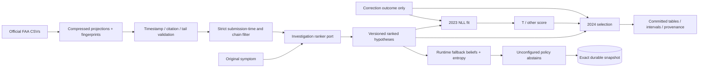
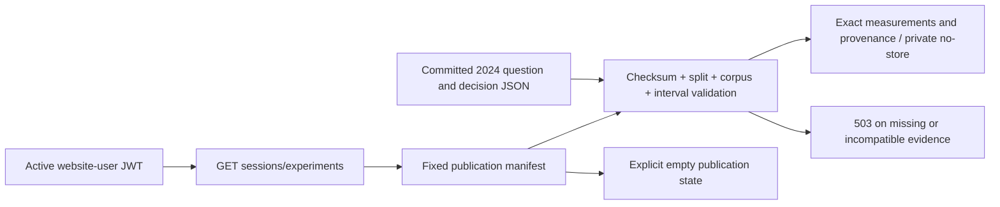
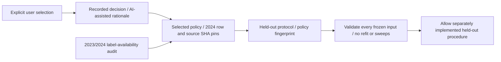

# Decision selection

1. An explicitly AI-assisted design draft precedes the pure decision code.
2. Stream official 2023/2024 sources into separate compressed projections; verify
   row fingerprints on read. This preparation does not access held-out 2025.
3. Validate timestamps, citations and tails. For every known-outcome pair, use
   original text as query and correction part only as answer key.
4. Filter every read by strictly earlier submission and exclude the query chain.
   Assign supersession only from corrections visible at that knowledge time.
5. Run the unchanged bounded Mid-I ranker through the port. Fit T/c on 2023 only.
6. Use those parameters on 2024, generate the threshold table, grouped error
   diagnostics and 1,000 cluster-bootstrap intervals; do not auto-select a point.
7. Default runtime Copilot derives uncalibrated beliefs and unconfigured abstention; the
   session service stores the exact response, hypothesis beliefs and entropy.
8. [Offline question selection](FLOW-question-selection.md) follows with strict temporal counts. Live questions and accepted research thresholds are implemented; activation remains an explicit gate; the fixed 2025 run is now verified.

Failures are explicit: naive timestamps invalid; malformed source fingerprint
fails; ambiguous IDs are counted/excluded; incompatible ranker parameters fail;
unknown policy never enables answer. Empty answered sets report null accuracy.

## Read-only product publication

Service/API-key principals receive 403; anonymous callers receive the shared
authentication failure. Reads do not activate a policy or evaluate 2025.

## Stopping-policy comparison after questions

```mermaid
flowchart LR
  Protocol[Fixed grid / 2024 input SHA pins] --> Verify[Validate traces / initial fit / methods]
  Verify --> Prefix[Replay actual policy on saved question prefixes]
  Prefix --> Stop[Answer / ask / abstain with unchanged named evidence counts]
  Stop --> Score[Downstream correction-key scoring only]
  Score --> Cluster[Shared original-report bootstrap draws]
  Cluster --> Table[All cohorts / controls / strata / intervals]
  Table --> Independent[Independent scalar stopping-metric verifier]
  Independent --> Review[Usman accepts answer .80 / gain .50]
```

The hosted-only full sweep reads committed 2024 artifacts, never raw 2025 data,
a graph or a model endpoint. Inconsistent inputs and existing result directories
fail. A saved posterior is never used before its simulated question is applied.

## Frozen point before test access

Preflight only reads committed frozen artifacts. It does not download/evaluate
2025 or enable managed runtime. Protocol retains all controls, part-change
strata, 1000 cluster draws, ECE and abstention-off comparison, plus the
predeclared label-availability sensitivity analysis.

## Controlled held-out execution

```mermaid
flowchart LR
  Synthetic[Synthetic 2025 cases / full CI on exact head] --> Label[Explicit run-frozen-held-out label event]
  Label --> Hashes[Validate policy / protocol / procedure source hashes]
  Hashes --> History[Download or load exact frozen 2023/2024 projections]
  History --> Receipt[Write pre-access receipt]
  Receipt --> Test[2025 official projection / frozen-receipt metadata]
  Test --> Rank[Same bounded ranker / strict earlier time and chain exclusion]
  Rank --> Questions[Original-field answers / fixed 2023 schema and beliefs]
  Questions --> Metrics[All controls and strata / 1000 cluster intervals / ECE]
  Metrics --> Verify[Independent point scoring and full interval replay]
  Verify --> Artifacts[Results / traces / source fingerprints / receipts]
```

Ordinary PR events perform preflight only. Download/evaluation requires an
explicit label event and successful exact-head full-stack checks. No source
overwrite, refitting or sweep is allowed. Missing/mismatched historical data
stops before test access; existing test data needs matching freeze provenance.

Completed hosted run 44906082558 / source 5a5060b retains 157 test pairs, all
72 stopping tables, question curves, intervals, ECE, source fingerprints and
pre-access history-restoration receipt. Independent metric and interval replay
passed. Source 5a5060b passed exact-head full CI before access. The run label
is removed; ordinary CI replays saved artifacts without a new source access.
See HELD_OUT_VERIFICATION.md for results and preserved errors; numeric settings
and policy fingerprint remain unchanged. Product publication is still separate.
