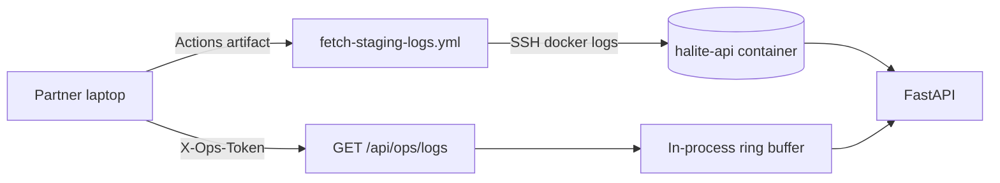
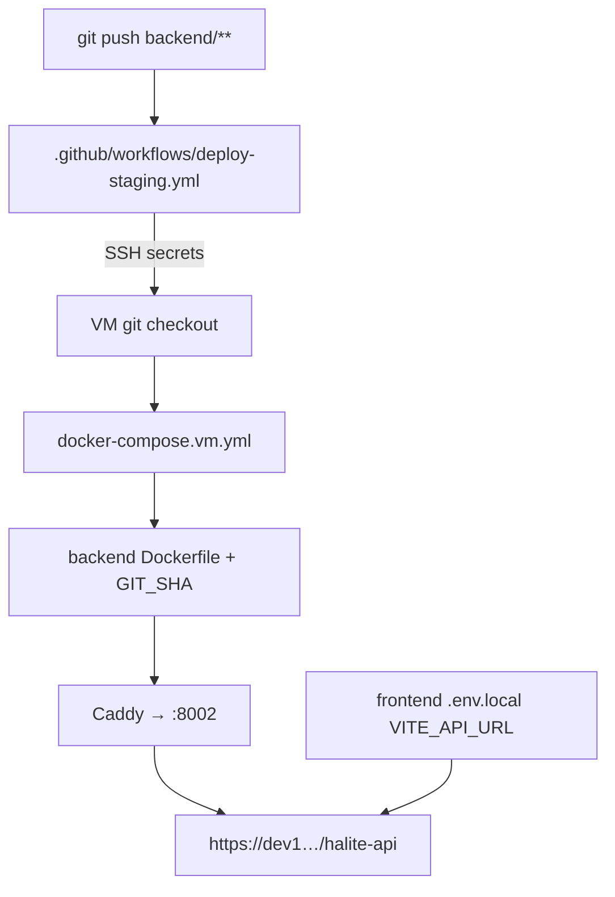

# FLOW-deploy — centralized backend updates

## Happy path

1. Engineer pushes backend change to an allowed branch (or runs workflow_dispatch).
2. GitHub Actions `deploy-staging.yml` SSHes to the VM.
3. VM checks out the SHA and rebuilds `halite-api` via `docker-compose.vm.yml`.
4. Public `/api/health` and `/api/ops/version` show the new `git_sha`.
5. Frontends using `VITE_API_URL=…/halite-api/api` see the new behavior immediately.

## Log visibility path

## Deploy dependency graph

## Failure modes

| Case | What to do |
| --- | --- |
| Workflow fails “Missing secret” | Admin adds `VM_SSH_*` + `VM_DEPLOY_PATH` |
| Health OK but maintenance 404 | Old image still running; redeploy current SHA |
| Ops logs 503 | Set `OPS_TOKEN` in VM `backend/.env` and recreate container |
| Ops logs 401 | Wrong/missing `X-Ops-Token` header |
