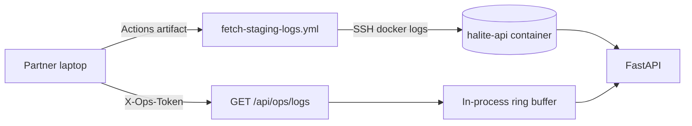
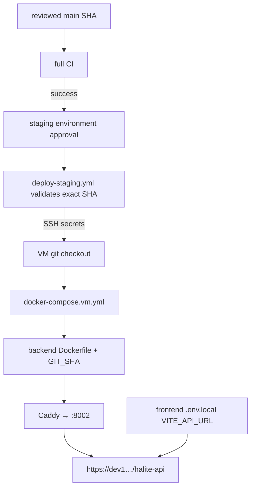

# FLOW-deploy — centralized backend updates

## Happy path

1. Reviewed work lands on `main` and the full `CI` workflow succeeds.
2. `deploy-staging.yml` validates the exact `main` SHA and CI result, then
   waits for the protected `staging` environment approval.
3. The workflow records the currently deployed SHA for rollback evidence.
4. GitHub Actions SSHes to the VM, which checks out the approved SHA and
   rebuilds `halite-api` via `docker-compose.vm.yml`.
5. Public `/api/health` and `/api/ops/version` must show the exact new SHA.
6. Frontends using `VITE_API_URL=…/halite-api/api` see the new behavior.

## Log visibility path

## Deploy dependency graph

## Failure modes

| Case | What to do |
| --- | --- |
| Workflow fails “Missing secret” | Admin adds `VM_SSH_*` + `VM_DEPLOY_PATH` |
| Health OK but maintenance 404 | Old image still running; redeploy current SHA |
| Ops logs 503 | Set `OPS_TOKEN` in VM `backend/.env` and recreate container |
| Ops logs 401 | Wrong/missing `X-Ops-Token` header |
| Frontend CI is red | Deployment remains blocked; fix on Shahmeer's branch, never bypass the gate |
| Manual SHA is not a `main` ancestor | Dispatch fails before SSH |
| Rollback needed | Use the recorded prior SHA, `rollback` + `ROLLBACK`, successful CI, and environment approval |
