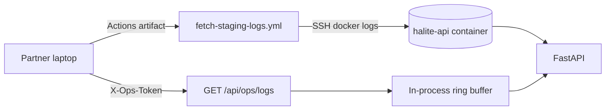
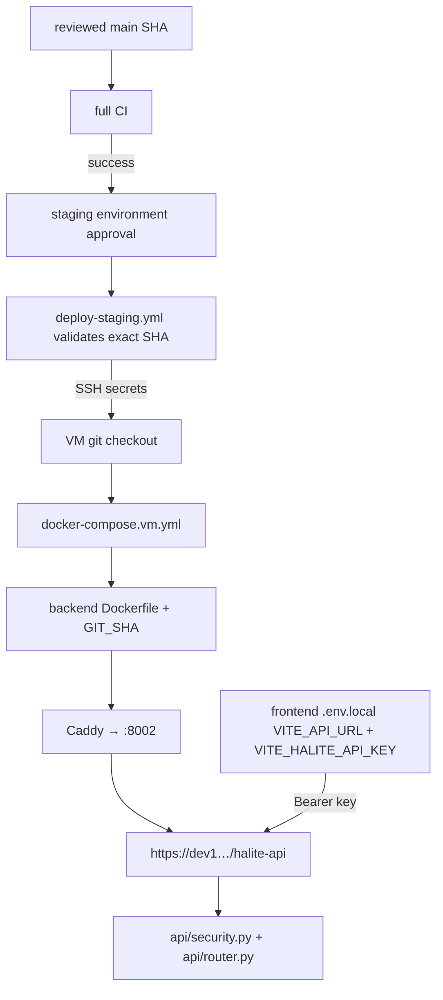

# FLOW-deploy — centralized backend updates

## Happy path

1. Reviewed work lands on `main` and the full `CI` workflow succeeds.
2. `deploy-staging.yml` validates the exact `main` SHA and CI result, then uses
   the `staging` environment. Once administrators configure required reviewers,
   GitHub also waits for their approval; until then the workflow confirmation
   is the only manual-intent gate.
3. The workflow records the currently deployed SHA for rollback evidence.
4. GitHub Actions SSHes to the VM, which checks out the approved SHA and
   rebuilds `halite-api` via `docker-compose.vm.yml` (non-root `10001:10001`, read-only rootfs, `noexec` tmpfs).
5. `scripts/vm/remote_deploy.sh` and the workflow verify that public `/api/health` and `/api/ops/version` show the exact new SHA (`auth_enabled=true`, `openapi_enabled=false`), anonymous `/api/maintenance/assets` returns `401`, `/docs` returns `404`, `/api/webhook/gitea` returns `404`, and authenticated `Bearer <HALITE_API_KEY>` returns `200`.
6. Frontends using `VITE_API_URL=…/halite-api/api` + `VITE_HALITE_API_KEY` see the new behavior.

## Log visibility path

## Deploy dependency graph

## Failure modes

| Case | What to do |
| --- | --- |
| Workflow fails “Missing secret” | Admin adds `VM_SSH_*` + `VM_DEPLOY_PATH` |
| Health OK but maintenance 404 | Old image still running; redeploy current SHA |
| Ops logs 503 | Set `OPS_TOKEN` in VM `backend/.env` and recreate container |
| Protected `/api/*` 503 | `DEMO_MODE=false` without `HALITE_API_KEY` (fail-closed); set `HALITE_API_KEY` in VM `backend/.env` and recreate |
| Protected `/api/*` 401 | Missing/wrong `Authorization: Bearer <HALITE_API_KEY>` (or `VITE_HALITE_API_KEY` missing in client env) |
| Ops logs 401 | Wrong/missing `X-Ops-Token` header |
| Frontend CI is red | Deployment remains blocked; fix on Shahmeer's branch, never bypass the gate |
| Manual SHA is not a `main` ancestor | Dispatch fails before SSH |
| Rollback needed | Use the recorded prior SHA, `rollback` + `ROLLBACK`, successful CI, and environment approval |

After full legacy retirement, `/api/webhook/gitea` is unregistered and returns
404. Both VM-local and public release probes require404; they no longer expect
the earlier disabled-handler410. A cross-layer test compares both release
expectations with the actual router response. Authenticated/anonymous asset,
closed docs, PostgreSQL and exact-version checks remain unchanged.

## Read-only research operation alongside releases

The manual staging-model-reference workflow is not a deployment. Exact-source
main CI and the currently deployed SHA must agree before any model call. It
inspects private configuration/container metadata, temporarily forwards only a
hosted-runner loopback socket, runs the fixed reference prompts and verifies
unchanged release/corpus/container state afterwards. Secrets are never output
artifacts. No existing release/auth/security/version gate is bypassed.
