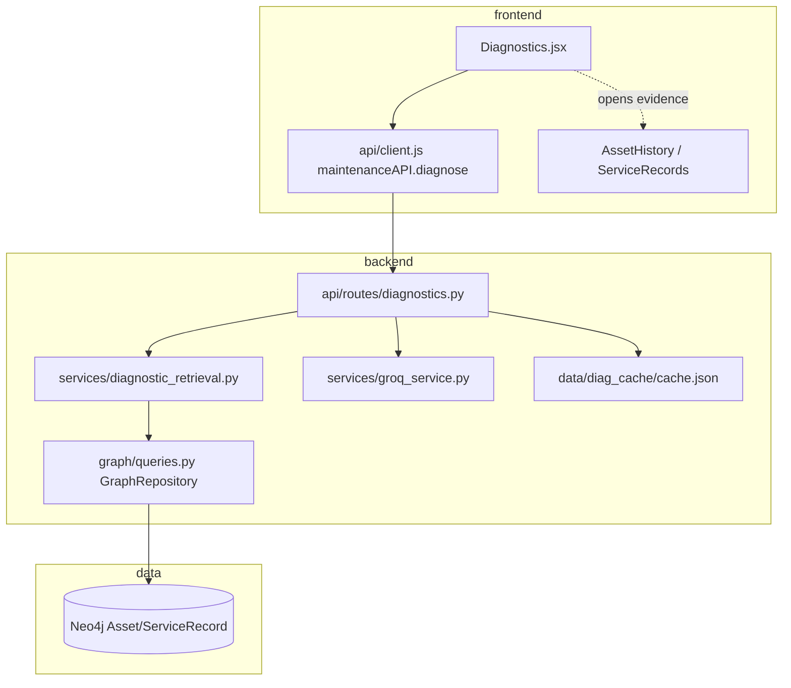

# FLOW-diagnose — symptom to ranked checks

## Actors

Technician (UI) → Frontend → `POST /api/maintenance/diagnose` → retrieval + rank → citation validate → optional LLM explain → UI renders `ranked_checks`.

## Happy path

1. User selects asset from `/api/maintenance/assets` (real corpus ID).
2. Opens Diagnostics; enters symptom text.
3. UI calls `maintenanceAPI.diagnose(assetId, symptomText)`.
4. Backend loads/builds diagnostic context from Neo4j (bounded history + similar records).
5. Ranker orders investigative checks with evidence record IDs.
6. LLM (or cache) produces explanation constrained to retrieved IDs.
7. `validate_citations` (`services/citation_validation.py`) confirms/flags IDs.
8. UI shows ranked list, explanation, warnings, citation status; user opens a cited record.

## Failure modes

| Case | Expected |
| --- | --- |
| Unknown asset | Controlled 404 / empty — no invented history |
| No relevant history | Empty/low ranked checks; no fabricated repair |
| Groq down, no cache | HTTP 503 with clear message |
| Model invents ID | Citation validator rejects/flags |

## UI states (Diagnostics.jsx)

| Response | UI |
| --- | --- |
| 200 with ranking + explanation | ranked checks (with per-check record ids), analysis, citation status, evidence cards, decision-support notice |
| 200, ranking but empty `explanation` | ranking + "No written explanation returned" notice (no Analysis, no citations) |
| 200, no ranking and no evidence | "Insufficient evidence"; ranking and narrative withheld |
| 404 | "No service history for this aircraft" (no retry) |
| 422 | "Check the request" with flattened field messages |
| 429 / 5xx / network | explicit message + Try again |
| 503 | "Diagnostic model unavailable" + backend reason; no diagnosis shown |

Note: with the model unavailable, an unknown asset also returns 503 (the live-model check runs before the history check).
Evidence/record ids open `/app/asset-history/<asset uuid>#<record_id>`; the page scrolls to and marks that record.

## Dependency graph

## File dependencies (edges)

- `Diagnostics.jsx` → `client.js` → `diagnostics.py`
- `diagnostics.py` → `diagnostic_retrieval.py` → `queries.py` → Neo4j
- `diagnostics.py` → `groq_service.py` + diag cache
- UI evidence click → history/record routes (`maintenance.py`)
- `Diagnostics.jsx` → `utils/diagnostics.js` (error mapping, explanation recovery, `[UNVERIFIED]` split)
- `AssetHistory.jsx` reads `#record_id` and scrolls to `record-<id>`
