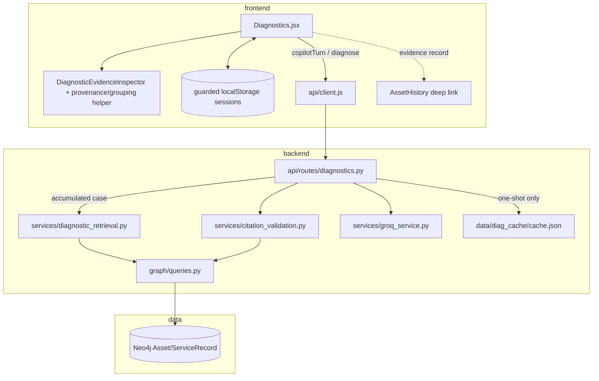

# FLOW-diagnose — evidence-grounded investigation

## Actors and entry points

- Technician → Diagnostics **Copilot** → `POST /api/maintenance/copilot/turn`
- Technician → **Quick diagnose** → `POST /api/maintenance/diagnose`

The one-shot contract is preserved. Copilot adds a stateless multi-turn path;
the browser sends the structured case state on every request.

## Copilot happy path

1. Technician optionally selects an aircraft; **All fleet** is the default.
2. UI sends `{session_id?, asset_id?, message, case_state}`.
3. The model extracts new facts into strict case-state JSON. Invalid extraction
   retains the raw message instead of discarding it.
4. Retrieval runs again over all accumulated symptoms and observations. An
   aircraft filter adds its bounded history; fleet retrieval remains bounded by
   `FLEET_SCAN_CAP`.
5. The established deterministic heuristic ranks active evidence. Ruled-out
   components and superseded records cannot become recommendations.
6. The backend compares the previous and new deterministic rankings and emits
   moved-up/down/new/dropped components plus newly retrieved record IDs.
7. For report help, explicit IDs or aircraft/date/topic criteria select records
   deterministically before model summarization.
8. The model phrases a reply only from supplied records and asks at most one
   question. Citation validation flags unknown or out-of-context IDs.
9. The UI shows the thread, editable case state, movement badges, evidence,
   citation status, and deep links into aircraft history. Case State is the sole
   structured list of extracted case facts; the inspector does not repeat it.
   Selecting a current ranked component scopes the inspector strictly to that
   check's evidence IDs. It deterministically groups records only when exact
   aircraft identity, component, and condition agree; previews three exact-ID/date
   reports; labels same-aircraft, other-aircraft/fleet, or unavailable provenance;
   and expands each original narrative independently. Turn evidence is shown
   immediately and read-only asset-history/record-list APIs can resolve the
   original record without invoking the record conflict endpoint.
10. The current unsaved workspace is versioned and persisted separately from
    named saved sessions. Route remounts and refreshes hydrate it directly—without
    inference or ranking animation—and source-aware Asset History links return to
    `/app/diagnostics`. **New investigation** explicitly clears the active snapshot.
11. Named local sessions are saved/resumed/deleted with guarded `localStorage` calls.

## Quick-diagnose path

1. User selects an aircraft and enters one symptom.
2. Backend retrieves bounded asset and fleet context and ranks checks.
3. A live model phrases the explanation; citation validation verifies IDs.
4. Empty model content or an empty parsed explanation is an explicit 503, never
   a blank successful response.

## Failure modes

| Case | Expected |
| --- | --- |
| Unknown copilot aircraft | 404 before model work |
| Blank or >4000-character message | 422 |
| Copilot model unavailable/rate-limited/empty | 200, `llm_status:"unavailable"`, `reply:null`; ranking/evidence retained |
| No relevant records | Explicit no-relevant-history response; no invented records |
| Invalid or out-of-context citation | ID marked unverified and omitted from `valid_ids` |
| Superseded record | Visible as superseded evidence, absent from recommendation inputs |
| Browser storage denied/corrupt | Chat remains usable; session persistence warning |
| Quick diagnose empty model output | 503 with explicit detail |

## Dependency graph

## File dependencies

- `Diagnostics.jsx` → `client.js` → `diagnostics.py`
- `Diagnostics.jsx` → `DiagnosticEvidenceInspector.jsx` → `utils/diagnosticEvidence.js`
- `diagnostics.py` → additive copilot helpers in `diagnostic_retrieval.py`
- `diagnostic_retrieval.py` → `queries.py` → Neo4j/memory store
- `diagnostics.py` → `groq_service.py` + `citation_validation.py`
- One-shot `/diagnose` retains its diagnostic cache path
- Evidence click → `/app/asset-history/<asset uuid>#<record_id>`
