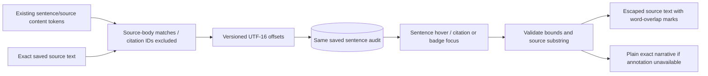
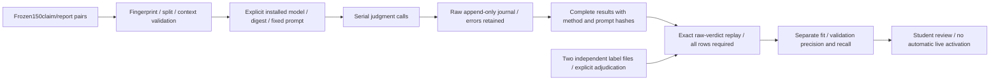

# Grounding path

1. Check access/open state; snapshot optional explicit checker configuration before inference.
2. Generate prose or apply a structured answer using existing session rules.
3. Split exact prose; check citation membership in shown/saved evidence (L2).
4. Compute max single-report containment, optional cosine and lexical guards (L3).
5. Withhold unvalidated ratings, or apply explicit experimental/selected thresholds.
6. Atomically save response, narratives, configuration and grounding JSON; exact GET replay.
7. Render sentence Markdown, status/reason and saved source panels. Quick diagnosis
   follows the same audit with an additive evidence snapshot and no prose rewrite.
8. Independently label the frozen packet; calculate agreement and explicitly
   adjudicate differences, fit 99 pairs, validate 51, then request Usman's decision.

```mermaid
flowchart LR
  Access[Owner / open / revision] --> Config[Freeze checker configuration]
  Config --> Reply[Original response and exact evidence]
  Reply --> Split[Sentence spans and citation IDs]
  Split --> L2[Saved evidence membership]
  L2 --> L3[Containment / optional dense / guards]
  Config --> L3
  L3 --> Ratings[Unrated or explicit configured ratings]
  Ratings --> Commit[Existing atomic turn transaction]
  Commit --> Saved[(PostgreSQL response and audit)]
  Saved --> UI[Exact replay / sentence badges / source panel]
  Corpus[Frozen 2023 / 2024 corpus] --> Packet[150 blinded pairs]
  Packet --> Humans[Usman and Umar independent labels]
  Humans --> Agree[Kappa and explicit adjudication]
  Agree --> Fit[99 fit / 51 validation]
  Fit --> Decision[Unaccepted proposal for Usman's decision]
  Decision -. accepted configuration .-> Config
```

Missing/malformed configuration fails 503 before model calls. Encoder outage is
reported and cannot silently convert dense thresholds into validated lexical
ratings. Unknown citations remain unsupported. Invalid/partial/foreign labels,
mixed reviewer identities, overlapping source splits or unresolved adjudications
fail evaluation; they are never dropped to improve a reported metric.

## Word-location extension

The display annotation does not participate in support thresholds, guard decisions
or calibration. Never recreate old audit positions on GET or infer a support label
from highlighted words. Source selection stays bound to its saved turn.

## Offline L4 instrument

This evaluates constructed pairs, not model-written explanations. No human
labels or real model judgments are generated by synthetic CI checks. Any failed
judge row prevents full-set metrics; quote existence is not entailment proof.
