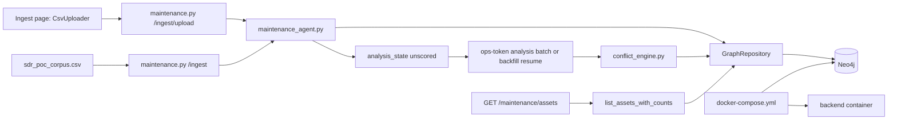

# FLOW-ingest — FAA CSV to graph

## Happy path

1. `python scripts/fetch_sdr_data.py` (or use existing processed CSV).
2. `POST /api/maintenance/ingest` with default path `data/processed/sdr_poc_corpus.csv`.
3. `MaintenanceAgent` creates `Asset` + unscored `ServiceRecord` (`confidence=null`), `ABOUT`, and chronological `PRECEDED_BY`.
4. Idempotent: second ingest skips duplicates (`duplicates_skipped`).
5. UI path: the Ingest page's **Upload CSV** panel posts the file (multipart `file`) to
   `POST /api/maintenance/ingest/upload`, which runs the same agent on a temporary file.
   Dates must be `MM/DD/YYYY`; an unreadable CSV currently returns an unhandled HTTP 500.
6. Health shows `maintenance_corpus_loaded` + non-zero count.
7. `GET /api/maintenance/assets` returns assets and counts through one
   repository aggregation; it does not issue one history query per asset.

## Dependency graph

## Caveats

- Do not `docker compose down -v` against the only demo volume without backup.
- Real FAA corpus is gitignored; CI uses synthetic `mid1_smoke.csv`.
- Ingest never fabricates a confidence. Legacy `auto_accepted`/`1.0` rows are
  handled by `scripts/migrate_conflict_analysis_state.py`, dry-run by default.
- Conflict scoring is separate and resumable via the backfill CLI or the
  ops-token batch endpoint. Shared staging is not mutated without approval.
