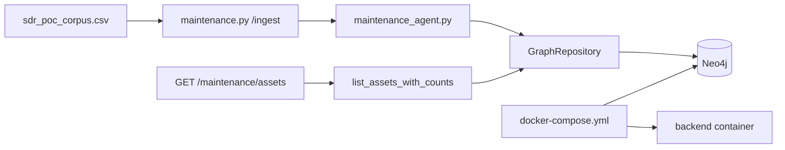

# FLOW-ingest — FAA CSV to graph

## Happy path

1. `python scripts/fetch_sdr_data.py` (or use existing processed CSV).
2. `POST /api/maintenance/ingest` with default path `data/processed/sdr_poc_corpus.csv`.
3. `MaintenanceAgent` creates/updates `Asset` + `ServiceRecord`, `ABOUT`, chronological `PRECEDED_BY`.
4. Idempotent: second ingest skips duplicates (`duplicates_skipped`).
5. Health shows `maintenance_corpus_loaded` + non-zero count.
6. `GET /api/maintenance/assets` returns assets and counts through one
   repository aggregation; it does not issue one history query per asset.

## Dependency graph

## Caveats

- Do not `docker compose down -v` against the only demo volume without backup.
- Real FAA corpus is gitignored; CI uses synthetic `mid1_smoke.csv`.
- Ingest sets `status=auto_accepted` and `confidence=1.0` as **placeholders**. Conflict scoring is a separate step (`process_record` / `scripts/backfill_conflict_scores.py`). If Review Queue is empty and every confidence is 1.0, see [`docs/mid1/16_usman_conflict_score_backfill_handoff.md`](../../docs/mid1/16_usman_conflict_score_backfill_handoff.md) (Usman).
