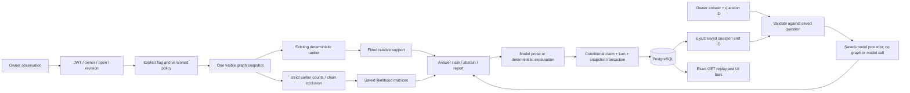

# Managed live flow

1. Verify user, ownership, open session and current revision; load the last response.
2. If the feature is disabled, retain the existing compatible session bridge.
3. For a new observation, load explicit policy and validate source/version metadata.
4. Freeze visible graph/ABOUT scope; extract facts and rank using the unchanged
   bounded algorithm. Build likelihoods at the identical submission-time cutoff.
5. Apply earlier answers to new beliefs, choose answer/ask/abstain or report, and
   save a unique question ID with its fixed basis, matrices, codebook and policy.
6. On a structured answer, validate ID/attribute/value against the last saved
   question, update the posterior and choose again using **saved** models only.
7. Commit the conditional revision, response, prior/posterior and snapshot atomically.
8. Render only confirmed response fields; reload/restart replays exact saved data.

409 handles stale question/turn, exhausted question/closed session and closure
races; 422 rejects unoffered values; invalid configuration/snapshot fails 503.
Database failure rolls everything back, including question consumption. A disabled
feature never silently applies answers. Shared-shell mobile usability needs its
separately authorized review integration; desktop/browser question flow is verified.
