# Model comparison flow

1. Verify frozen 2023/2024 corpus fingerprints and existing 2024 ranked cases.
2. Select 20 distinct originals deterministically; validate earlier, chain-excluded
   evidence and remove downstream outcome fields from the comparison packet.
3. Bundle fixed packet and standard-library runner with source/file hashes.
4. On the target host, record actual runner hardware and exact installed server/
   model identities; verify the requested measurement role before generation.
5. Warm each active model; make serial primary and paired no-evidence prose calls.
6. Save raw response/failure, timing, prompt fingerprint and assessment per attempt.
7. Generate task/arm-specific table and JSON with honest denominators and null
   unvalidated metrics. Usman reviews actual outputs and decides the model.
8. Resume only when packet/method/settings/machine/model identities still match;
   reuse saved attempts, rewarm unfinished models and never auto-retry failures.

```mermaid
flowchart LR
  Sources[Frozen 2023 / 2024 corpus] --> Packet[20 original observations]
  Ranks[Existing ranked selection cases] --> Packet
  Packet --> Scope[Earlier evidence / full chain exclusion]
  Scope --> Bundle[Fixed packet + reproducible ZIP]
  Bundle --> Identity[Runner hardware / server version / model digest]
  Identity --> Warm[Excluded warmup]
  Warm --> Calls[Serial facts and paired prose arms]
  Calls --> Journal[(Fsynced raw responses / errors)]
  Journal --> Audit[Schema / citations / lexical sentence audit]
  Audit --> Table[JSON + generated comparison table]
  Table --> Decision[Usman's model decision pending]
  Journal --> Resume[Validate identity and raw assessments]
  Resume --> Warm
```

Missing/changed model, altered source/packet, malformed checker configuration,
foreign or partial journal, and false M4 role fail explicitly. Provider failures
are retained and count against validity. No validated threshold means no invented
semantic-support rate. The model is not permitted to choose the server's ranking,
question, decision or approved maintenance action through this experiment.
