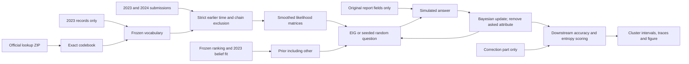

# Question selection

1. Verify official FAA lookup archive and extract exact code descriptions.
2. Freeze attribute vocabulary using 2023 only; load frozen 2023 belief parameters.
3. Load frozen 2024 baseline cases and validate the exact source fingerprint.
4. At each original SubmissionDate, count only earlier records outside its chain.
5. Select by expected information gain or seeded uniform random; no-question
   control preserves priors. Simulated answers use only the original report.
6. Apply posterior, exclude the asked attribute even for not-sure, repeat to three.
7. Score correction outcomes downstream; cluster bootstrap by original report.
8. Save traces, provenance, controls and figures; independently replay all metrics.

Malformed matrices/source mismatch fail explicitly; backwards temporal queries
fail; unoffered answers become not-sure in simulation; no empirical threshold is
installed automatically. Runtime session answers are still refused pending live
integration. Ingest/backfill preparation is a separate review change.
