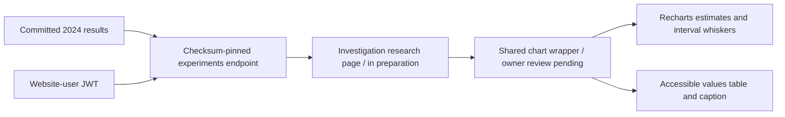

# Published research display

1. Website-user JWT authorizes the static sessions experiments endpoint.
2. Fixed manifest paths and checksums verify committed selection artifacts.
3. The feature page selects a saved cohort/metric; it never recomputes research.
4. The shared Recharts wrapper renders estimates and stored confidence intervals,
   with sample/year captions and an accessible table retaining undefined values.
5. Empty and unavailable publications have separate UI states. Missing data never
   becomes invented zero measurements or a chosen operating point.

Corrupt evidence fails with 503 at the API. Authentication errors remain explicit.
The shared wrapper and dependency are a review proposal, not a completed owner
handoff or deployed page. No 2025 result or accepted policy is implied.
