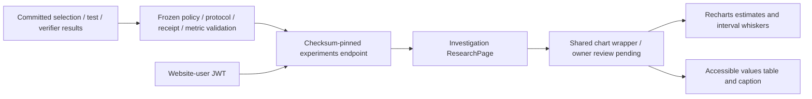

# Published research display

1. Website-user JWT authorizes the static sessions experiments endpoint.
2. Fixed manifest paths/checksums verify selection/test artifacts and the independent test receipt.
3. The feature page selects a saved cohort/metric; it never recomputes research.
4. The shared Recharts wrapper renders estimates and stored confidence intervals,
   with sample/year captions and an accessible table retaining undefined values.
5. Empty and unavailable publications have separate UI states. Missing data never
   becomes invented zero measurements or a chosen operating point. The accepted marker identifies the exact frozen 2024 joint-selection row.

Corrupt evidence fails with 503 at the API. Authentication errors remain explicit.
The shared wrapper and dependency remain an owner-review proposal. The page is
prepared on the stacked feature branch; owner handoff/deployment are not claimed. The verified frozen 2025 result and accepted 2024 policy are displayed as research evidence; no runtime activation is implied.

The default view shows 2025 fixed stopping points plus same-terminal-question
abstention-off, saved question curves, timing/part-change controls, exact
intervals/valid draws and ECE. Selection shows the accepted-gain saved curves
with an exact scoped marker. A third evidence-set choice preserves the earlier
pre-question study. Shared chart stage captions distinguish held-out from
selection. The v2 transport sends only the accepted gain slice from the pinned
full selection file; actual experiment outputs remain unchanged.
