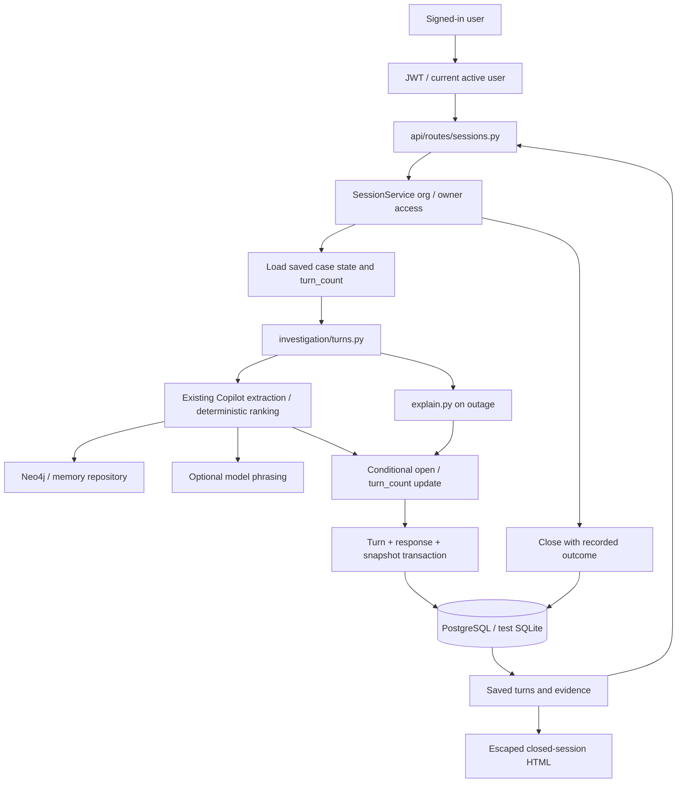
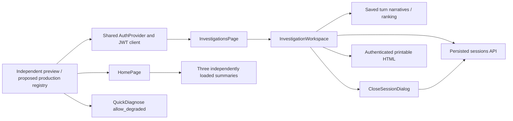
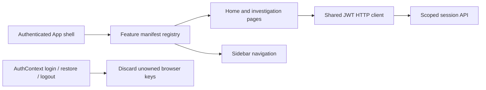

# Sessions flow

1. Website user JWT is verified by the shared authentication dependency.
2. `POST /api/sessions` validates an optional aircraft and stores owner/org IDs
   from the verified principal. Browser-supplied ownership is never accepted.
3. `POST /api/sessions/{id}/turns` verifies ownership/open status and loads the
   latest persisted case state. The model may extract facts/write prose; the
   existing deterministic ranker supplies hypotheses and evidence.
4. On an outage, the session bridge supplies a ranking-derived template. The
   measured policy/grounding packages are explicitly unconfigured at this stage.
5. A conditional session update reserves the next index only if the session is
   still open and unchanged. Turn, full response and snapshot commit atomically.
6. GET detail replays saved responses without new inference. Lists and summary
   apply organisation/owner filters in SQL; supervisors read other users' sessions.
7. Close stores a non-blank outcome note and optional finding; future turns fail.
   A closed session can be read as an escaped printable HTML report.

## Failure cases

- Non-user service principal: 403; inaccessible session: 404.
- Supervisor mutating another user's readable session: 403.
- Unknown aircraft: 404; blank/oversized message or outcome: 422.
- Closed session, concurrent stale turn, repeated closure or answer without an
  active question: 409. Retry after reloading; no partial state was committed.
- Missing relational store: 503, never a pretend browser-only persistence success.
- Model unavailable: session turn still returns ranking/evidence/template.

## Prepared frontend feature path

The investigation/home feature manifests provide history, workspace, quick
diagnosis and dashboard routes. Their independent preview uses the real shared
AuthProvider/HTTP client and the same sessions API. History/resume/reload issue
GETs only; new messages and closure wait for confirmed POST responses. Old turn
narratives are rendered from saved responses. An uncertain write requires reload
before another send; matching saved text clears an already-committed draft.
The user has authorized a separately reviewed shell/auth integration. Until it is
applied and verified, preview evidence is not production-route evidence.

## Shared-shell integration review

On `codex/usman-ui-integration`, App routes → discovered manifests → feature
pages → shared JWT client → session API. Sidebar consumes manifest navigation.
AuthContext clears unowned legacy keys on restoration/login/logout. Login/invite
and app-index defaults go to home; Diagnostics redirects to history.

Main-shell browser verification covers redirects, refresh, logout and another
account's direct saved-session URL. Owner review/merge/deploy are separate gates.

## Belief snapshot extension

The Copilot ranker port → stable score/other beliefs → unconfigured policy inputs
are included in each new saved response. Snapshot hypotheses carry their beliefs
and `belief_entropy` stores the same entropy. Existing saved turns replay exactly
without recomputation. See [FLOW-decision-selection.md](FLOW-decision-selection.md).

## Managed question extension

The opt-in [managed flow](FLOW-live-questions.md) uses a strict visible graph snapshot for observations and saved matrices for structured answers. Unique question IDs reject replaced questions even for the same attribute. Prior/posterior, answer history and the budget share the existing CAS transaction and exact replay boundary. The default bridge remains unconfigured.

## Responsive shared shell (separate authorized review branch)

The same App → registry → feature → JWT client → sessions API path now has a
responsive shell proposal: below md, Sidebar becomes a 64px accessible icon rail;
at md and above it stays 256px. Main's flex item may shrink correctly. The
question control remains reachable at phone width; keyboard navigation and the
same confirmed logout/auth guard were verified in the built browser. There is no
new route, service, permission or storage flow. Owner review/merge remain pending.
