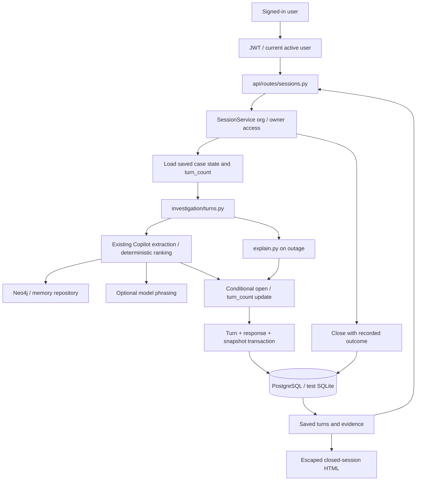
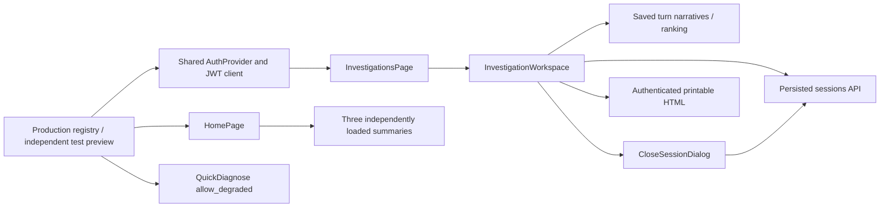
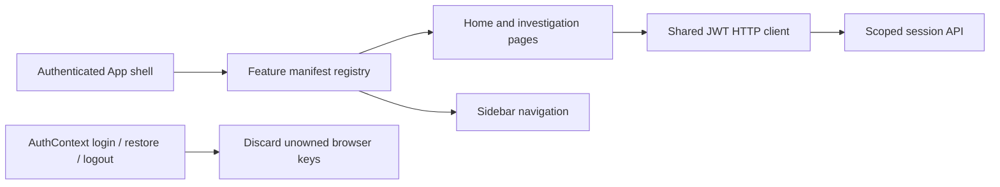

# Sessions flow

1. Website user JWT is verified by the shared authentication dependency.
2. `POST /api/sessions` validates an optional aircraft and stores owner/org IDs
   from the verified principal. Browser-supplied ownership is never accepted.
3. `POST /api/sessions/{id}/turns` verifies ownership/open status and loads the
   latest persisted case state. The model may extract facts/write prose; the
   existing deterministic ranker supplies hypotheses and evidence.
4. On an outage, the session bridge supplies a ranking-derived template. The
   default live policy is unconfigured; citation/sentence audits explicitly retain
   unrated support until human calibration is accepted. Managed questions require
   their own explicit runtime flag and compatible policy.
5. A conditional session update reserves the next index only if the session is
   still open and unchanged. Turn, full response and snapshot commit atomically.
6. GET detail replays saved responses without new inference. Lists and summary
   apply organisation/owner filters in SQL; supervisors read other users' sessions.
7. Close stores a non-blank outcome note and optional finding; future turns fail.
   A closed session can be read as an escaped printable HTML report.

## Failure cases

- Non-user service principal: 403; inaccessible session: 404.
- Supervisor mutating another user's readable session: 403.
- Unknown aircraft: 404; blank/oversized message or outcome: 422.
- Closed session, concurrent stale turn, repeated closure or answer without an
  active question: 409. Retry after reloading; no partial state was committed.
- Missing relational store: 503, never a pretend browser-only persistence success.
- Model unavailable: session turn still returns ranking/evidence/template.

## Integrated frontend feature path

The investigation/home feature manifests provide history, workspace, quick
diagnosis and dashboard routes. Their independent preview uses the real shared
AuthProvider/HTTP client and the same sessions API. History/resume/reload issue
GETs only; new messages and closure wait for confirmed POST responses. Old turn
narratives are rendered from saved responses. An uncertain write requires reload
before another send; matching saved text clears an already-committed draft.
The user-authorized shell/auth integration landed through PR48. Current public
read evidence is in PUBLIC_BROWSER_VERIFICATION.md; independent owner review
remains separate. The original preview evidence by itself is not a production
claim.

## Shared-shell integration review

Originally prepared on `codex/usman-ui-integration` and now merged, App routes → discovered manifests → feature
pages → shared JWT client → session API. Sidebar consumes manifest navigation.
AuthContext clears unowned legacy keys on restoration/login/logout. Login/invite
and app-index defaults go to home; Diagnostics redirects to history.

Disposable main-shell browser verification covers redirects, refresh, logout and
another account's direct saved-session URL. Actual public read verification also
covers redirects/refresh/logout; it does not probe other people's production
sessions. Integration is merged/deployed; owner cross-review remains separate.

## Belief snapshot extension

The Copilot ranker port → stable score/other beliefs → unconfigured policy inputs
are included in each new saved response. Snapshot hypotheses carry their beliefs
and `belief_entropy` stores the same entropy. Existing saved turns replay exactly
without recomputation. See [FLOW-decision-selection.md](FLOW-decision-selection.md).

## Managed question extension

The opt-in [managed flow](FLOW-live-questions.md) uses a strict visible graph snapshot for observations and saved matrices for structured answers. Unique question IDs reject replaced questions even for the same attribute. Prior/posterior, answer history and the budget share the existing CAS transaction and exact replay boundary. The default bridge remains unconfigured.

## Integrated responsive shared shell

The same App → registry → feature → JWT client → sessions API path now has a
responsive shell: below md, Sidebar becomes a 64px accessible icon rail;
at md and above it stays 256px. Main's flex item may shrink correctly. The
question control remains reachable at phone width; keyboard navigation and the
same confirmed logout/auth guard were verified in the built browser. There is no
new route, service, permission or storage flow. Integrated through PR48; independent
owner review remains pending. Actual public390px main width326px is retained in
phase26 evidence.

Sentence auditing freezes configuration before inference and commits the full
source/score/guard audit with the existing turn transaction. GET never recomputes
historical audits. See [FLOW-grounding.md](FLOW-grounding.md).

## Explicit dedicated-account public lifecycle probe

```mermaid
flowchart LR
  Confirm[VERIFY_SESSION / exact source / fresh output] --> Login[Dedicated authorized account login]
  Login --> Aircraft[Read existing aircraft only]
  Aircraft --> Case[Create labelled own test session]
  Case --> Turn[One turn / no automatic retry]
  Turn --> Replay[New HTTP read / exact response and snapshot]
  Replay --> Close[Close without outcome part / no actual finding]
  Close --> Print[Authenticated report / closed-write409]
  Print --> State[Confirm unchanged source and corpus]
  State --> Logout[Explicit logout / secret-free proof]
```

This additional probe writes only its newly created dedicated-account session.
It never ingests records, administers users, changes model settings or assigns a
real finding. A successful fallback lifecycle is not accepted as live model prose;
those gates remain separately recorded. Uncertain writes are retained for recovery,
not automatically retried.

Actual release11beed1 passed mainCI44992947098/deploy44993176097. The
fresh public lifecycle case74c792ce-510c-4c60-addb-a7f441435246 persisted/replayed/
closed/printed correctly but compact model prose still timed out; live success
is not established. Hosted browser44993544541 verified this populated own-case
workspace, exact reload, closure guard and one-click PDF along with real auth,
phone geometry and research parity. PDF visual review found crowded text
at zero-margin page boundaries. Report print CSS now requests A4/16mm margins,
keeps fitting evidence items together and sets paragraph widows/orphans; browser
export honors CSS page size. The correction requires fresh deployed PDF review.
See docs/work/usman/PUBLIC_SESSION_VERIFICATION.md and phase28 raw artifacts.

Final print release: mainCI44994039620/deploy44994297938 passed; public health
confirmed exact6c3cd0d6fbac7a703570894257f0cad738a4e14b and2,079records.
Hosted browser44994441004 passed real own-case replay, closure and one-click
print plus all public read/auth/phone checks, with zero page errors/prohibited
requests. All4exportedPDF pages rendered and visually reviewed; all20record IDs
and20full normalized narratives independently match the saved response. New
PDF SHA2568ec1c3dbdc0830b1d5242de0cc62c1324f0e15a731c513f1103f199a7c0fc839.
A close-up of the original disproved the initially suspected missing glyphs;
the confirmed issue was zero-margin edge crowding. Correction is now visually
accepted. Model availability remains failed on both measured runtime paths.
