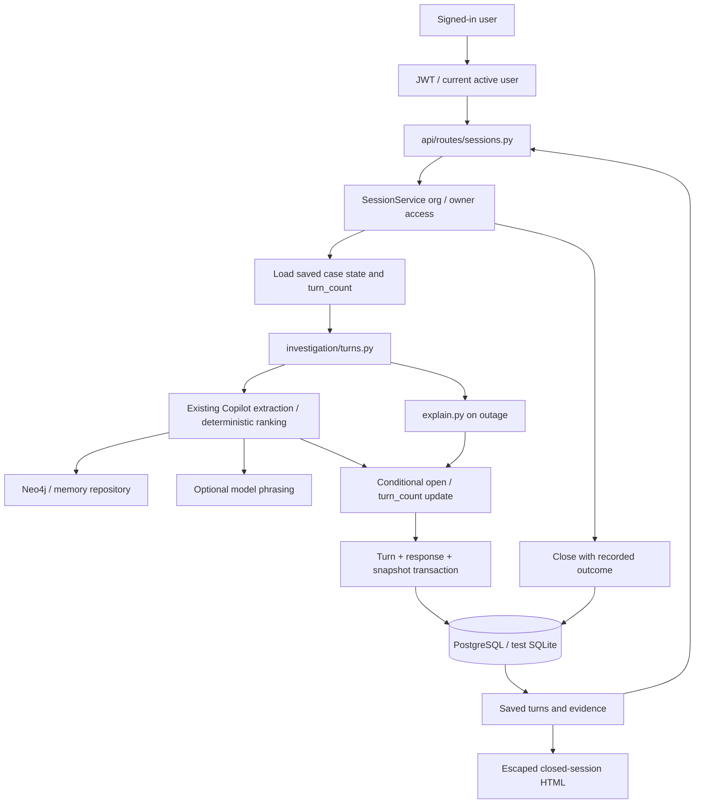

# Sessions flow

1. Website user JWT is verified by the shared authentication dependency.
2. `POST /api/sessions` validates an optional aircraft and stores owner/org IDs
   from the verified principal. Browser-supplied ownership is never accepted.
3. `POST /api/sessions/{id}/turns` verifies ownership/open status and loads the
   latest persisted case state. The model may extract facts/write prose; the
   existing deterministic ranker supplies hypotheses and evidence.
4. On an outage, the session bridge supplies a ranking-derived template. The
   measured policy/grounding packages are explicitly unconfigured at this stage.
5. A conditional session update reserves the next index only if the session is
   still open and unchanged. Turn, full response and snapshot commit atomically.
6. GET detail replays saved responses without new inference. Lists and summary
   apply organisation/owner filters in SQL; supervisors read other users' sessions.
7. Close stores a non-blank outcome note and optional finding; future turns fail.
   A closed session can be read as an escaped printable HTML report.

## Failure cases

- Non-user service principal: 403; inaccessible session: 404.
- Supervisor mutating another user's readable session: 403.
- Unknown aircraft: 404; blank/oversized message or outcome: 422.
- Closed session, concurrent stale turn, repeated closure or answer without an
  active question: 409. Retry after reloading; no partial state was committed.
- Missing relational store: 503, never a pretend browser-only persistence success.
- Model unavailable: session turn still returns ranking/evidence/template.
